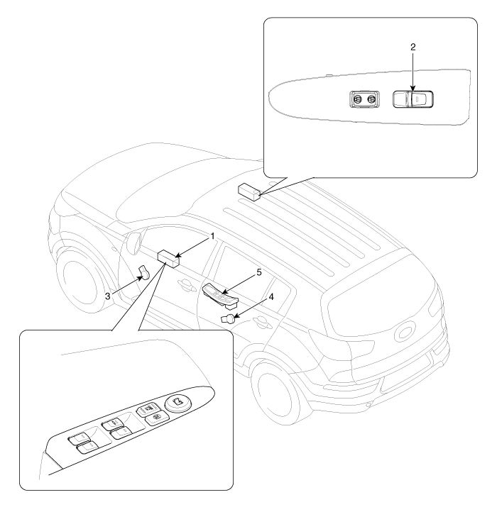

# Kia Sportage: Componentes e Localização dos Componentes

[Home](../../index.md) / [Manual de Serviço e Reparo do Kia Sportage SL](../sportage-482.md) / [Sistema Elétrico do Corpo](sportage-984.md) / [Janelas Elétricas](sportage-1085.md) / Componentes e Localização dos Componentes

## Localização dos Componentes

| 1. Interruptor principal do vidro elétrico do motorista 2. Interruptor do vidro do passageiro 3. Motor do vidro frontal | 4. Motor do vidro traseiro 5. Interruptor do vidro traseiro |
| --- | --- |
