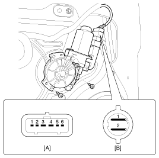
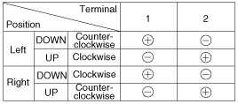
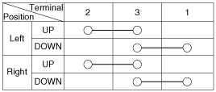
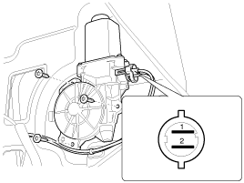
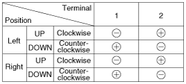

# Kia Sportage: Motor de Janela Elétrica: Procedimentos de Reparo

[Home](../../index.md) / [Manual de Serviço e Reparo do Kia Sportage SL](../sportage-482.md) / [Sistema Elétrico do Corpo](sportage-984.md) / [Janelas Elétricas](sportage-1085.md) / Procedimentos de Reparo do Motor de Janela Elétrica

## Inspeção

Motor de Janela Elétrica da Dianteira

1. Remova o terminal (-) negativo da bateria.

2. Remova o trim da porta dianteira.

   (Consulte o grupo BD - "Porta dianteira")

3. Desconecte o conector do motor.

   (A : Segurança, B : Padrão)

   

4. Conecte os terminais do motor diretamente à tensão da bateria (12V) e verifique se o motor opera suavemente. Em seguida, inverta a polaridade e verifique se o motor opera suavemente no sentido contrário. Se a operação for anormal, substitua o motor.

   [Padrão]

   

5. Conecte os terminais 2 e 3 diretamente à tensão da bateria (12V) e verifique se o motor opera suavemente quando conectar os terminais abaixo.

   [Segurança]

   

Motor de Janela Elétrica do Traseiro

1. Remova o terminal (-) negativo da bateria.

2. Remova o trim da porta traseira.

   (Consulte o grupo BD - "Porta traseira")

3. Desconecte o conector do motor.

   

4. Conecte os terminais do motor diretamente à tensão da bateria (12V) e verifique se o motor opera suavemente. Em seguida, inverta a polaridade e verifique se o motor opera suavemente no sentido contrário. Se a operação for anormal, substitua o motor.

   
