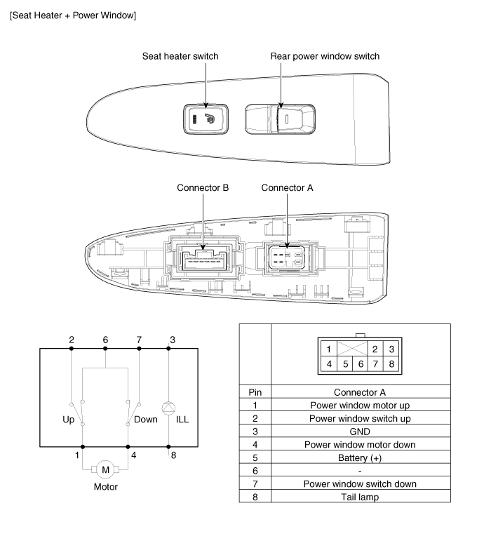

# Interruptor de Janela Eletrônica — Componentes e localização

[Home](../../index.md) / [Manual de Serviço e Reparo](../sportage-482.md) / [Sistema Elétrico do Corpo](sportage-984.md) / [Janelas Eletrônicas](sportage-1085.md) / Componentes e localização

## Diagrama (Interruptor Principal de Janela Eletrônica)

## Diagrama (Interruptor de Janela Eletrônica do Passageiro)

## Diagrama (Interruptor de Janela Eletrônica Traseira)

