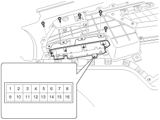
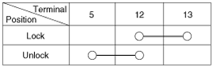
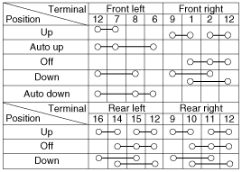
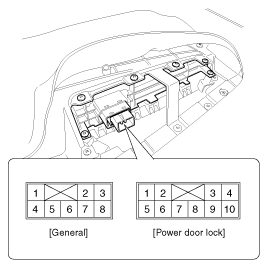
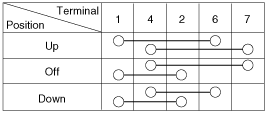
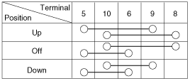
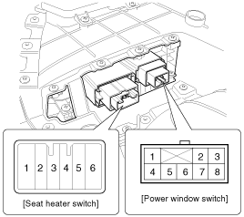
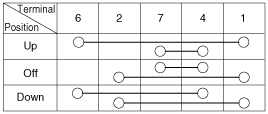

# Kia Sportage: Interruptor de Janela Elétrica: Procedimentos de Reparo

[Início](../../index.md) / [Manual de Serviço e Reparo do Kia Sportage SL](../sportage-482.md) / [Sistema Elétrico do Corpo](sportage-984.md) / [Janelas Elétricas](sportage-1085.md) / Procedimentos de Reparo do Interruptor de Janela Elétrica

## Inspeção

Inspeção do Interruptor Principal de Janela Elétrica

1. Desconecte o terminal negativo (-) da bateria.

2. Remova a capa do porta-malas e o interruptor de janela elétrica.

   (Consulte o grupo BD - "Porta dianteira")

3. Verifique a continuidade entre os terminais em cada posição do interruptor de acordo com a tabela. Se a condição de continuidade não for normal, substitua o interruptor.

   

   

   [Auto Subir/Descer (Condutor)]

   

Inspeção do Interruptor de Janela Elétrica do Passageiro

1. Desconecte o terminal negativo (-) da bateria.

2. Remova a capa do porta-malas e o interruptor de janela elétrica.

   (Consulte o grupo BD - "Porta dianteira")

3. Verifique a continuidade entre os terminais em cada posição do interruptor de acordo com a tabela. Se a condição de continuidade não for normal, substitua o interruptor.

   

   [Geral]

   

   [Bloqueio da Porta Elétrico]

   

Inspeção do Interruptor de Janela Elétrica Traseira

1. Desconecte o terminal negativo (-) da bateria.

2. Remova a capa da porta traseira.

   (Consulte o grupo BD - "Porta traseira")

3. Remova o módulo do interruptor de janela elétrica traseira.

   

4. Verifique a continuidade entre os terminais em cada posição do interruptor de acordo com a tabela. Se a condição de continuidade não for normal, substitua o interruptor.

   [Geral]

   
