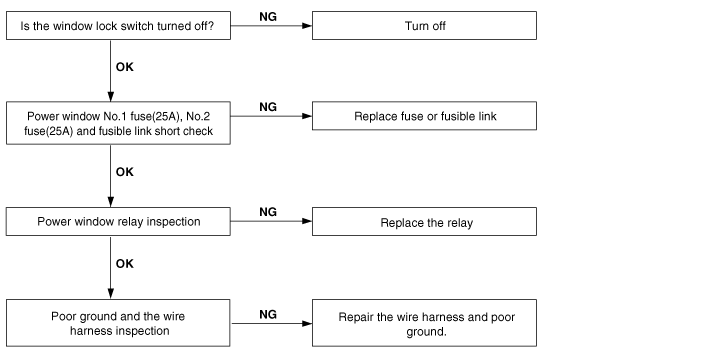
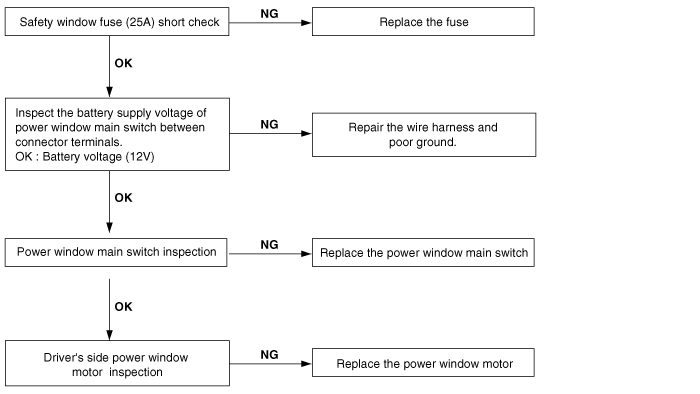
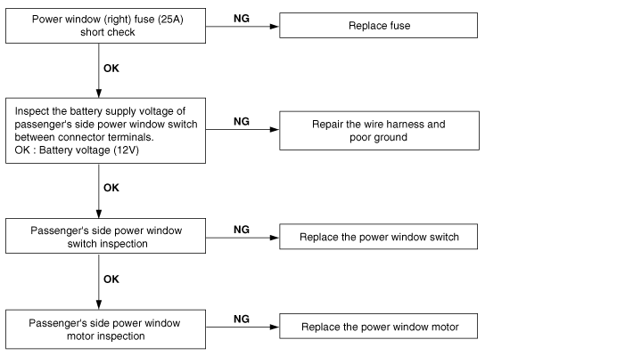

# Kia Sportage: Diagnóstico

[Home](../../index.md) / [Manual de Serviço e Reparo do Kia Sportage SL](../sportage-482.md) / [Sistema Elétrico do Corpo](sportage-984.md) / [Janelas Elétricas](sportage-1085.md) / Diagnóstico

## Diagnóstico

1. Nenhuma janela opera a partir do interruptor principal na porta do motorista.

   

2. Janela do lado do motorista não opera.

   

3. Janela do lado do passageiro não opera.

   
