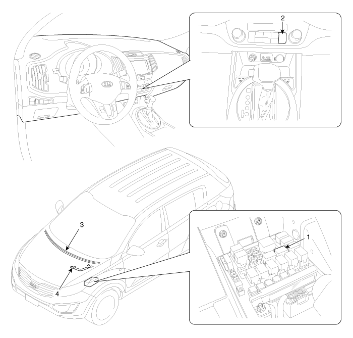

# Kia Sportage: Componentes e Localização dos Componentes

[Home](../../index.md) / [Manual de Serviço e Reparo do Kia Sportage SL](../sportage-482.md) / [Sistema Elétrico do Corpo](sportage-984.md) / [Descongelador de Vidro Parabrisas](sportage-1092.md) / Componentes e Localização dos Componentes

## Localização dos Componentes

| 1. Descaldeador de vidro parabrisas relé 2. Descaldeador de vidro parabrisas interruptor | 3. Descaldeador de vidro parabrisas 4. Conector de descaldeador |
| --- | --- |
