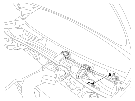
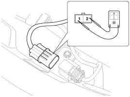
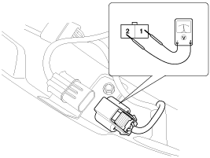

# Kia Sportage: Descongelador de Vidro: Procedimentos de Reparo

[Home](../../index.md) / [Manual de Serviço e Reparo do Kia Sportage SL](../sportage-482.md) / [Sistema Elétrico do Corpo](sportage-984.md) / [Descongelador de Vidro](sportage-1092.md) / Procedimentos de Reparo do Descongelador de Vidro

## Inspeção

1. Remova a cobertura superior do cowl.

   (Consulte o limpador de vidros)

2. Desconecte o conector do descongelador de vidro (A) do mecanismo do limpador de vidros.

   

3. Verifique a continuidade entre os terminais das linhas do descongelador.

   

4. Ligue o interruptor de ignição e o interruptor de descongelador de vidro, depois mede a tensão entre os terminais do conector do descongelador de vidro do lado do harness.

   ```
   OK : aproximadamente a tensão da bateria (12V)
   ```

   
