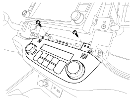
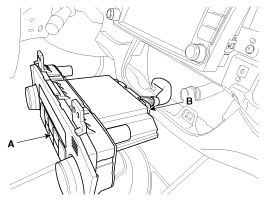
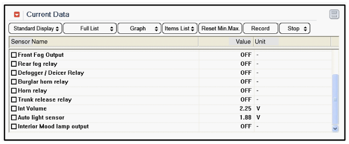
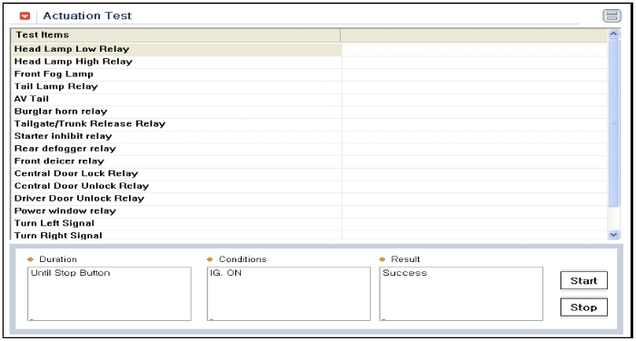

# Kia Sportage: Interruptor do Descongelador de Vidro: Procedimentos de Reparo

[Home](../../index.md) / [Manual de Serviço e Reparo do Kia Sportage SL](../sportage-482.md) / [Sistema Elétrico do Corpo](sportage-984.md) / [Descongelador de Vidro](sportage-1092.md) / Procedimentos de Reparo do Interruptor do Descongelador de Vidro

## Remoção

1. Desconecte o terminal negativo (-) da bateria.

2. Remova a placa de fascia central.

   (Consulte BE - "Som")

3. Remova o controlador do aquecedor e do ar condicionado (A) após desconectar o conectador (B).

   

   

   > **Nota**
   >
   > - Cuide para não danificar o gancho ao remover o controlador do aquecedor e do ar condicionado.

## Instalação

1. Instale o controlador do aquecedor e do ar condicionado.

2. Instale a placa de fascia central.

## Inspeção

1. Os entradas do interruptor do descongelador de vidro podem ser verificadas usando o GDS.

2. Para verificar o valor de entrada do interruptor do descongelador de vidro, selecione a opção "BCM".

3. Selecione a opção "Dados Atuais".

   

4. Para verificar o valor de entrada do interruptor do descongelador de vidro no modo de força, selecione a opção.

   
