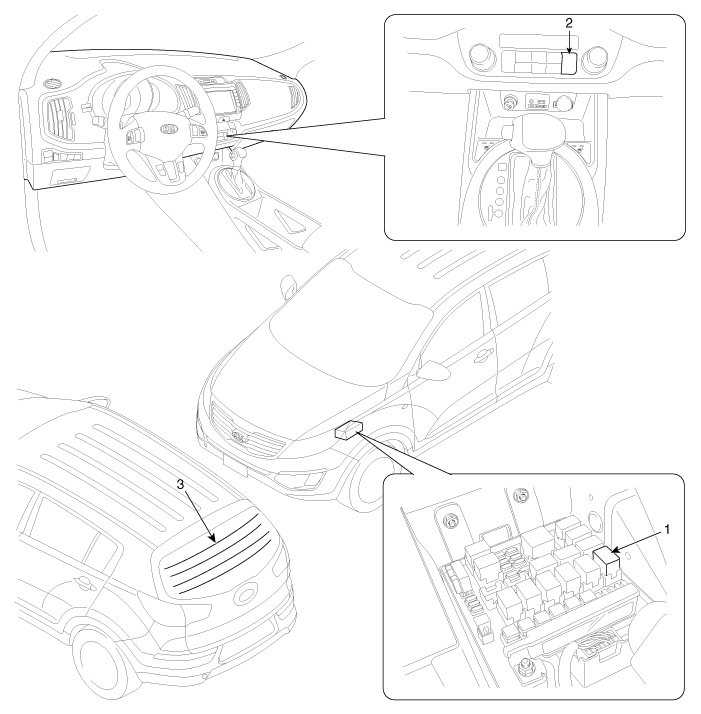

# Kia Sportage: Componentes e Localização dos Componentes

[Home](../../index.md) / [Manual de Serviço e Reparo do Kia Sportage SL](../sportage-482.md) / [Sistema Elétrico do Corpo](sportage-984.md) / [Desfogador de Vidro Traseiro](sportage-1097.md) / Componentes e Localização dos Componentes

## Localização dos Componentes

| 1. Interruptor relé do desfogador de vidro traseiro 2. Interruptor do desfogador de vidro traseiro | 3. Desfogador de vidro traseiro |
| --- | --- |
