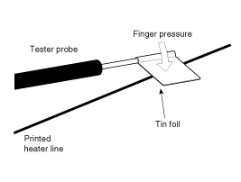
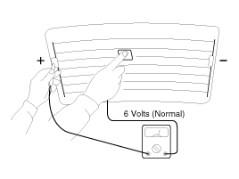
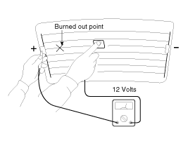
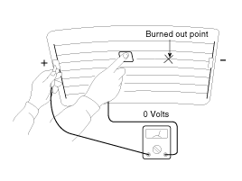
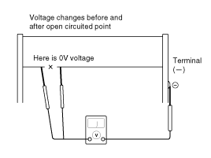
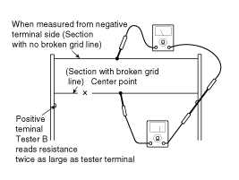
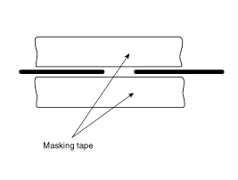

# Kia Sportage: Defletor de névoa do vidro traseiro: Procedimentos de reparo

[Home](../../index.md) / [Manual de Serviço e Reparo do Kia Sportage SL](../sportage-482.md) / [Sistema Elétrico do Corpo](sportage-984.md) / [Defletor de Névoa do Vidro Traseiro](sportage-1097.md) / Procedimentos de reparo do Defletor de Névoa do Vidro Traseiro

## Inspeção

> **Cuidado**
>
> - Envolva um pedaço de alumínio de folha em volta do final do cabo do voltmeter para evitar danificar a linha do aquecedor. Aperte o alumínio com o polegar, movendo-o ao longo da grade para verificar a existência de circuitos abertos.

1. Ligue o interruptor do defletor e use um voltmeter para medir a tensão de cada linha do aquecedor no ponto central do vidro. Se o voltmeter indicar uma tensão de aproximadamente 6V, a linha do aquecedor do vidro traseiro é considerada satisfatória.

   

2. Se uma linha do aquecedor estiver queimada entre o ponto central e o terminal (+), o voltmeter indicará 12V.

   

3. Se uma linha do aquecedor estiver queimada entre o ponto central e o terminal (-), o voltmeter indicará 0V.

   

4. Para verificar a existência de circuitos abertos, mova lentamente o cabo do voltmeter na direção que o circuito aberto parece existir. Tente encontrar um ponto onde uma tensão é gerada ou muda para 0V. O ponto onde a tensão mudou é o ponto do circuito aberto.

   

5. Use um ohmmeter para medir a resistência de cada linha do aquecedor entre um terminal e o centro de uma grade, e entre o mesmo terminal e o centro de uma linha do aquecedor adjacente. A seção com uma linha do aquecedor quebrada terá uma resistência duas vezes maior que as outras seções. Na seção afetada, mova o cabo do voltmeter para uma posição onde a resistência muda bruscamente.

   

### Reparo da Linha do Aquecedor Quebrada

Prepare os seguintes itens:

1. Pintura condutiva.

2. Tintura de dissolvente.

3. Goma isolante.

4. Removível de silicone.

5. Usando um pincel fino:

   Limpe o vidro adjacente à linha do aquecedor quebrada, limpe com removível de silicone e fixe a goma isolante conforme mostrado. Agite bem a embalagem de pintura condutiva, aplique três camadas com um pincel a intervalos de aproximadamente 15 minutos. Remova a goma isolante e aguarde um tempo adequado para secagem antes de aplicar a energia. Para um acabamento melhor, retire as sobras com uma faca após a pintura ter secado completamente. (Permita 24 horas).

   
