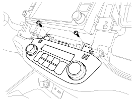
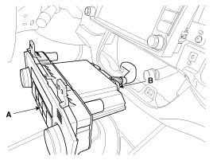
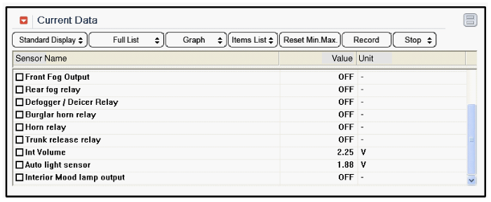
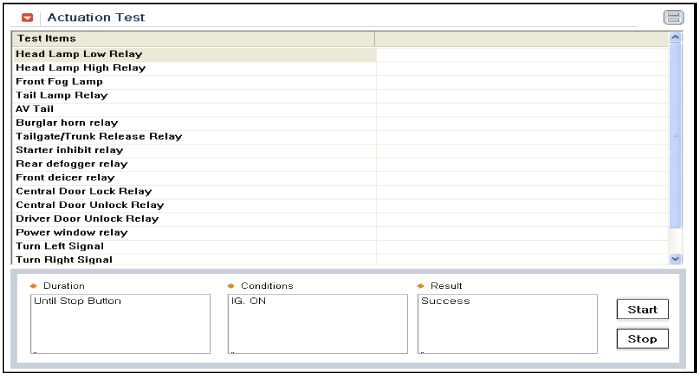

# Kia Sportage: Interruptor de Desfogador de Vidro Traseiro: Procedimentos de Reparo

[Home](../../index.md) / [Manual de Serviço e Reparo do Kia Sportage SL](../sportage-482.md) / [Sistema Elétrico do Corpo](sportage-984.md) / [Desfogador de Vidro Traseiro](sportage-1097.md) / Procedimentos de Reparo do Interruptor de Desfogador de Vidro Traseiro

## Remoção

1. Desconecte o terminal negativo (-) da bateria.

2. Remova o painel central de fascia.

   (Consulte BE - "Som")

3. Remova o controlador de aquecimento e ar condicionado (A) após desconectar o conectador (B).

   

   

   > **Nota**
   >
   > - Tenha cuidado ao remover o controlador de aquecimento e ar condicionado para não danificar a engancha.

## Instalação

1. Instale o controlador de aquecimento e ar condicionado.

2. Instale o painel central de fascia.

## Inspeção

1. Os entradas do interruptor de desfogador de vidro traseiro podem ser verificadas usando o GDS.

2. Para verificar o valor de entrada do interruptor de desfogador de vidro traseiro, selecione a opção "BCM".

3. Selecione a opção "Dados Atuais".

   

4. Para verificar o valor de entrada do interruptor de desfogador de vidro traseiro em modo de força, selecione a opção.

   
