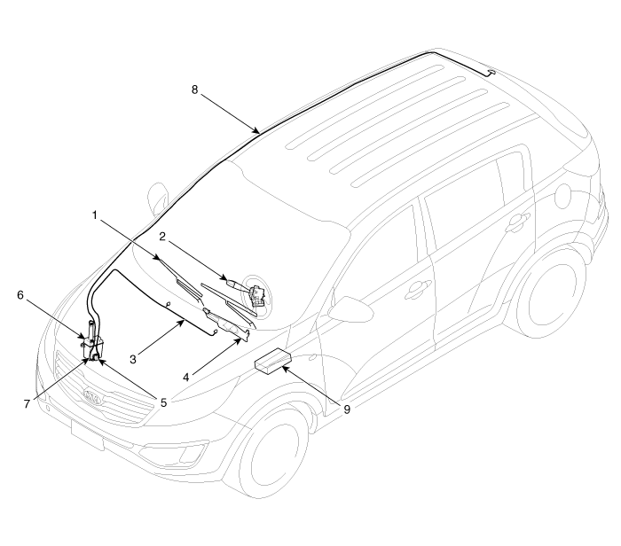

# Limpador e Desencanador do Para-brisa — Componentes e localização

[Home](../../index.md) / [Manual de Serviço e Reparo](../sportage-482.md) / [Sistema Elétrico do Corpo](sportage-984.md) / [Limpador e Desencanador do Para-brisa](sportage-1101.md) / Componentes e localização

## Diagrama

## Legenda

| Nº | Componente |
| --- | --- |
| 1 | Braço e lâmina do limpador do para-brisa |
| 2 | Interruptor e desencanador do limpador do para-brisa |
| 3 | Tubo do desencanador do para-brisa |
| 4 | Motor e ligamento do limpador do para-brisa |
| 5 | Motor do desencanador (Dianteiro) |
| 6 | Reservatório do desencanador |
| 7 | Motor do desencanador (Traseiro) |
| 8 | Tubo e bico do desencanador traseiro |
| 9 | Relé do limpador dianteiro (Caixa de relés do motor) |
