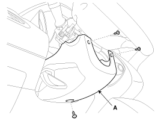
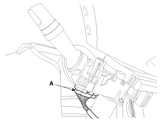
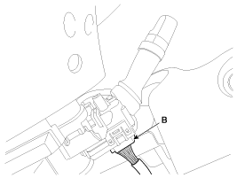
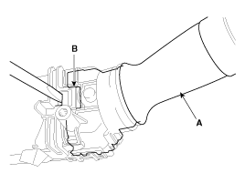
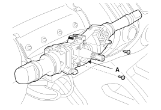
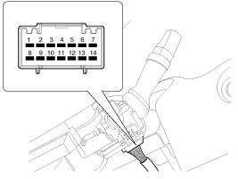
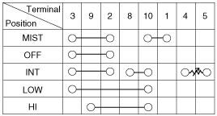
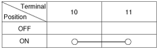
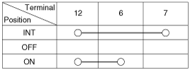
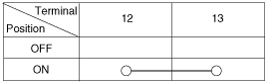

# Kia Sportage: Troca do Interruptor de Limpador e Lavador de Vidro do Para-brisa: Procedimentos de Reparo

[Home](../../index.md) / [Manual de Serviço e Reparo do Kia Sportage SL](../sportage-482.md) / [Sistema Elétrico do Corpo](sportage-984.md) / [Limpador e Lavador de Vidro do Para-brisa](sportage-1101.md) / Procedimentos de Reparo do Interruptor de Limpador e Lavador de Vidro do Para-brisa

## Remoção

1. Desconecte o terminal negativo (-) da bateria.

2. Remova as capas superiores e inferiores da coluna do volante (A) após remover 3 parafusos.

   

   > **Nota**
   >
   > - Cuide para não danificar e arranhar as capas e suas partes relacionadas.
   > - Cuide para não danificar o gancho ao remover as capas superiores e inferiores.

3. Desconecte o conectador do interruptor de luz (A) e o conectador do interruptor de limpador (B).

   

   

4. Remova o interruptor de limpador (A) empurrando o gancho de bloqueio (B).

   > **Nota**
   >
   > - Ao remover apenas o interruptor de limpador e lavador, libere o bloqueio do interruptor de limpador sem remover o volante.

   

5. Remova o volante.

   (Consulte o grupo ST - "Coluna e eixo do volante")

6. Remova o módulo do relógio.

   (Consulte o grupo RT - "Módulo do airbag")

7. Remova a montagem do interruptor multifuncional (A) após soltar os parafusos (2EA).

   

## Instalação

1. Instale o interruptor multifuncional após conectar o conectador.

2. Instale o módulo do relógio e o volante.

3. Instale as capas superiores e inferiores da coluna do volante.

## Inspeção

Verifique a continuidade entre os terminais ao operar o interruptor de limpador e lavador de vidro. Se não estiver na condição normal, substitua o interruptor de limpador e lavador de vidro.

Interruptor de Limpador

Interruptor de Lavador

Interruptor de Limpador do Vidro Traseiro

Interruptor de Lavador do Vidro Traseiro

