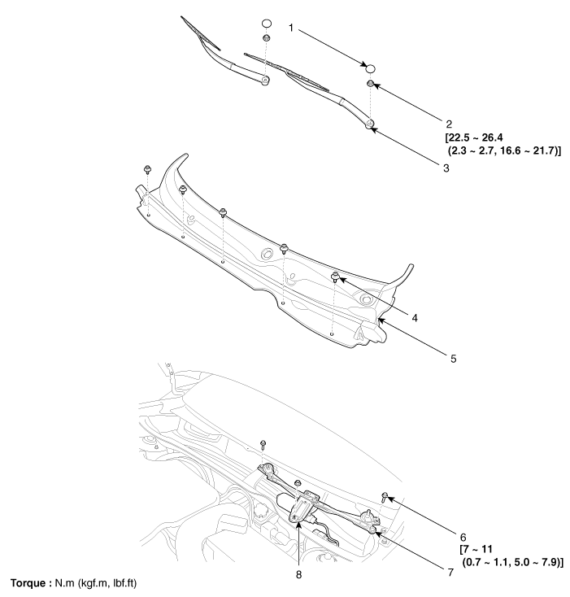

# Kia Sportage: Motor do Vidro Limpador da Dianteira: Componentes e Localização dos Componentes

[Início](../../index.md) / [Manual de Serviço e Reparo do Kia Sportage SL](../sportage-482.md) / [Sistema Elétrico do Corpo](sportage-984.md) / [Limpador e Lavador de Vidros](sportage-1101.md) / Motor do Vidro Limpador da Dianteira: Componentes e Localização dos Componentes

## Localização dos Componentes

| 1. Capa 2. Parafuso 3. Braço e lâmina do limpador de vidro 4. Ganchinho | 5. Cobertura superior do canto 6. Parafuso 7. Montagem do motor do limpador de vidro e ligadura 8. Conector do motor do limpador de vidro |
