# Kia Sportage: Motor de Despejo da Frente: Procedimentos de Reparo

[Home](../../index.md) / [Manual de Serviço e Reparo do Kia Sportage SL](../sportage-482.md) / [Sistema Elétrico do Corpo](sportage-984.md) / [Despejo e Lavagem do Vidro do Para-brisa](sportage-1101.md) / Motor de Despejo da Frente: Procedimentos de Reparo

## Remoção

1. Remova o braço e a lâmina do despejo do para-brisa após remover um parafuso (B) e a tampa do despejo (A).

   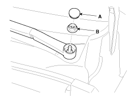

2. Remova o braço e a lâmina do despejo do para-brisa (A).

   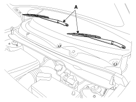

3. Se necessário, solte o clip de fixação da lâmina do despejo puxando para cima e remova a lâmina do despejo do raio interno do braço do despejo.

   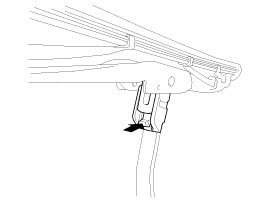

4. Remova a cobertura superior do cowl após remover as pinças (5EA).

   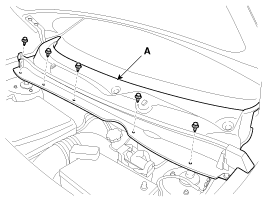

5. Desconecte o conector do motor de despejo (A) do conjunto do motor de despejo e da transmissão.

   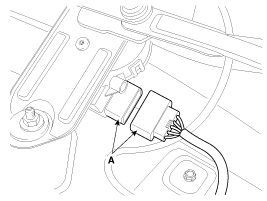

6. Remova o conjunto do motor de despejo e da transmissão (A) após remover 2 parafusos e um parafuso.

   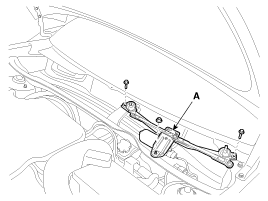

7. Segure o braço do motor de despejo e remova a transmissão superior (A) do braço do motor de despejo.

   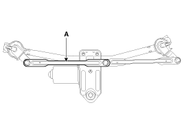

   > **Cuidado**
   >
   > - Antes de remover o conjunto do motor de despejo e da transmissão, verifique se a transmissão está parada na posição de parada automática.
   > - Para instalar o braço do motor de despejo exatamente, verifique se a transmissão está alinhada com o braço do motor em linha reta e o ângulo de cada transmissão.
   > - Coloque uma marca de ajuste no conjunto do motor de despejo e da transmissão.
   > - Cuide para não dobrar a transmissão.

8. Remova a transmissão inferior (A) do braço do motor de despejo.

   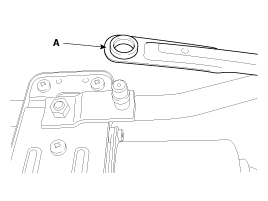

   > **Cuidado**
   >
   > - Para instalar o braço do motor de despejo exatamente, verifique se a transmissão está alinhada com o braço do motor em linha reta e o ângulo de cada transmissão.
   > - Cuide para não dobrar a transmissão.

9. Remova o braço do motor de despejo após soltar um parafuso (B).

   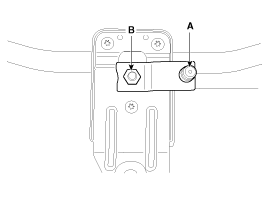

10. Remova o motor de despejo após soltar 3 parafusos.

    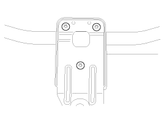

## Instalação

> **Cuidado**
>
> - Não permita que o braço do limpador de vidros toque no para-brisa, pois isso pode riscar ou quebrar o para-brisa.

1. Instale o motor do limpador de vidros.

2. Instale o braço articulado.

   ```
   Torque :
   12,7-17,6 N.m (1,3-1,8 kgf.m, 9,4-13,0 lbf.ft)
   ```

   > **Cuidado**
   >
   > - Para instalar o braço articulado do motor do limpador de vidros, certifique-se de que a
   ligação esteja alinhada com o braço articulado em linha reta e ajuste o ângulo
   de cada ligação usando o sinal de correspondência.

3. Instale as ligações superiores e inferiores no braço articulado do motor do limpador de vidros.

   > **Cuidado**
   >
   > - Para instalar o braço articulado do motor do limpador de vidros, certifique-se de que a
   ligação esteja alinhada com o braço articulado em linha reta e ajuste o ângulo
   de cada ligação.
   > - Cuide para não dobrar as ligações.

4. Instale a montagem do motor do limpador de vidros e das ligações e, em seguida, conecte o conector do motor do limpador de vidros.

   ```
   Torque :
   7-11 N.m (0,7-1,1 kgf.m, 5,0-7,9 lbf.ft)
   ```

5. Instale a cobertura superior do cowl.

6. Instale o braço e a lâmina do limpador de vidros.

   ```
   Torque :
   22,5~26,4 N.m (2,3~2,7 kgf.m, 16,6~21,7 lbf.ft)
   ```

   > **Nota**
   >
   > - O motor do limpador de vidros deve ser cycled para garantir que esteja na posição de parada.
   > - Se necessário, ajuste o braço do limpador de vidros e a lâmina.

7. Instale o braço e a lâmina do limpador de vidros na posição especificada (A).

   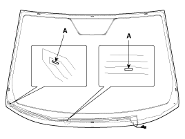

8. Posicione a cobertura superior do cowl na posição de aplicação de líquido especificada.

   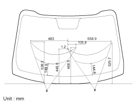

## Verificação

Verificação de Operação a Velocidade

1. Remova o conector (A) do motor do limpador de vidros.

   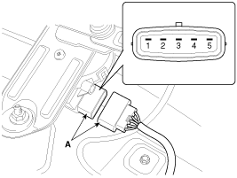

   | Número | Descrição | Número | Descrição |
   | --- | --- | --- | --- |
   | 1 | Terreno | 4 | Baixa |
   | 2 | P (Parada) | 5 | Alta |
   | 3 | Bateria (+) | | |

2. Conecte o cabo positivo (+) da bateria ao terminal 3 e o cabo negativo (-) ao terminal 1.

3. Verifique que o motor opera em velocidade baixa ou alta conforme a tabela abaixo.

   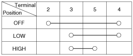

   > **Cuidado**
   >
   > - Fontes comuns de contaminação incluem insetos, resina de árvores e
   tratamentos com cera quente utilizados por alguns lavadores de carros comerciais. Se as lâminas não estiverem limpando corretamente, limpe tanto o vidro quanto as lâminas com um bom limpador ou sabão suave e lave bem com água limpa.
