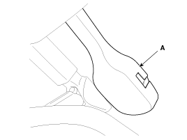

# Kia Sportage: Sensor de Chuva: Descrição e Operação

[Home](../../index.md) / [Manual de Serviço e Reparo do Kia Sportage SL](../sportage-482.md) / [Sistema Elétrico do Corpo](sportage-984.md) / [Limpador e Lavador de Para-brisa](sportage-1101.md) / Sensor de Chuva: Descrição e Operação

## Descrição

O sistema de limpador de para-brisa com sensor de chuva é um sistema de limpador que, além das funções normais de limpador (off, mist, manual baixa velocidade, manual alta velocidade, e lavagem), fornece controle automático de velocidades intermitente automática baixa, e alta.

Quando a chave de ignição estiver na posição ON, o sensor de chuva (A) será ativado.

## Função do Sistema

Princípio Básico

O feixe emitido pelo diodo de luminosidade é refletido integralmente contra o exterior do para-brisa, e então transformado no diodo fotovoltaico.

Se houver água no exterior do para-brisa, o feixe se separa
opticamente, e a intensidade do feixe restante é medida pelo diodo
fotovoltaico.

Se houver água no para-brisa, significa que o feixe não
foi refletido integralmente, então a intensidade do feixe perdido indica o grau de superfície do vidro molhada.

> **Nota**
>
> - O sensor de chuva consiste em dois diodos de luminosidade, dois diodos fotovoltaicos, fibras ópticas e uma superfície de acoplamento.

Controle de Operação

O ECU do limpador transmite o sinal como sensor de chuva, e então o
sensor de chuva percebe a água da chuva para transmitir a ordem de limpeza
ECU do limpador, o ECU do limpador controla o motor do limpador de acordo com o sinal.

Influência do Contato

O sensor de chuva pode falhar devido às seguintes condições

| • | Contaminação da superfície de medição. |
| --- | --- |

| • | Bolhas de ar entre o vidro e a superfície de contato do acoplamento. |
| --- | --- |

| • | Movimento do acoplamento devido a vibrações. |
| --- | --- |

| • | Limpador de para-brisa danificado. |
| --- | --- |

Condição de Operação

No caso de o motor iniciar com o interruptor do limpador em AUTO, a sensor de chuva ativa após uma operação do limpador para informar o motorista que o sistema está em AUTO.

> **Nota**
>
> - No caso de o sensor de chuva não funcionar ou falhar, é necessário a operação manual do interruptor do limpador pelo motorista.
