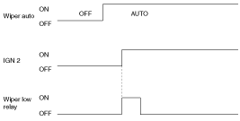
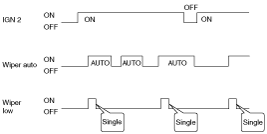
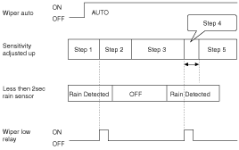
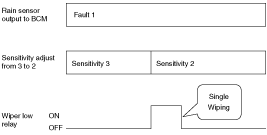
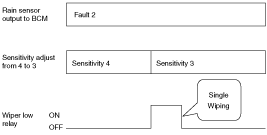
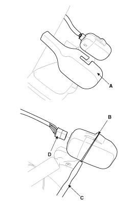
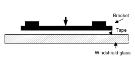

# Kia Sportage: Sensor de Chuva: Procedimentos de Reparo

[Home](../../index.md) / [Manual de Serviço e Reparo do Kia Sportage SL](../sportage-482.md) / [Sistema Elétrico do Corpo](sportage-984.md) / [Limpador e Lavador de Para-brisa](sportage-1101.md) / Procedimentos de Reparo do Sensor de Chuva

## Inspeção

Deslocador de Limpador Automático

1. No estado IGN2 ON, se a entrada de troca automática (comunicação LIN) estiver ON, então os relés de baixa e alta velocidade do limpador serão controlados pela entrada do sensor de chuva.

2. Se o deslocador de limpador estiver em modo automático com a ignição do veículo desligada, e depois a ignição do veículo for ligada, um deslocamento será realizado.

   

3. Um deslocamento será realizado sempre que a chuva for detectada (sinal Detectado de Chuva do sensor de chuva) e o deslocador de limpador for movido para a posição AUTOMÁTICO. Mas um deslocamento não será realizado quando o deslocador de limpador for movido para a posição AUTOMÁTICO e o sinal OFF estiver sendo recebido do sensor de chuva. Mas se o deslocador de limpador for movido para a posição AUTOMÁTICO pela primeira vez desde que a ignição do veículo foi ligada, um deslocamento será realizado independentemente do sinal Detectado de Chuva ou sinal OFF.

   

4. A unidade de controle pode ajustar o desempenho do sensor de chuva ajustando a entrada de sensibilidade. Quando em modo automático, o BCM realizará um deslocamento único cada vez que a sensibilidade for ajustada para um estabelecimento mais sensível (mais de um passo para cima). Este único deslocamento será realizado apenas se o sinal Detectado de Chuva estiver sendo recebido do sensor de chuva. Se a ajuste de sensibilidade for ajustado para mais de uma sensibilidade, o BCM realizará apenas um deslocamento a menos que o tempo entre as aumentos seja maior que 2 segundos.

   

5. Estratégia de falha para o sensor de chuva

   Falha do Sensor de Chuva 1 - Falha Interna Detectada

   Esta falha é detectada quando o limpador estiver em modo automático e a entrada de sensor de chuva defeituoso do sensor de chuva tiver um ciclo de duty correspondente à Falha 1. O atraso de confirmação para a falha é de 1 segundo.

   Quando esta falha é detectada, as saídas do limpador serão OFF e o limpador também fará um deslocamento em velocidade lenta na transição da sensibilidade 3 para a sensibilidade 2 (Passo 2 para 3) para indicar a presença desta falha. Se outra sensibilidade for definida, o limpador não fará qualquer deslocamento adicional.

   

   Falha do Sensor de Chuva 2 - Falha na Adesão ao Vidro Detectada

   Esta falha é detectada quando o limpador estiver em modo automático e a entrada de sensor de chuva defeituoso do sensor de chuva tiver um ciclo de duty correspondente à Falha 2. O atraso de confirmação para a falha é de 1 segundo.

   Quando esta falha é detectada, as saídas do limpador serão OFF e o limpador também fará um deslocamento na transição da sensibilidade 4 para a sensibilidade 3 (Passo 1 para 2) para indicar a presença desta falha. Se outra sensibilidade for definida, o limpador não fará qualquer deslocamento adicional.

   

   Falha do Sensor de Chuva 3 - Falta de Sinal de Entrada Presente

   Esta falha é detectada quando o limpador estiver em modo automático

e o ciclo de trabalho da entrada sensor de chuva defeituoso do sensor de chuva corresponde ao Falha 3 ou no caso em que o ciclo de trabalho da entrada sensor de chuva defeituoso é 0% ou 100%. O atraso de confirmação da falha é de 1 s.

   Quando essa falha é detectada, os saídos dos limpador são OFF.

## Remoção

> **Cuidado**
>
> - O sensor de chuva pode não funcionar corretamente se estiver sujo. Proteja a superfície do sensor de chuva não removendo o capuz até o momento da instalação. A superfície do sensor de chuva possui um adesivo na placa de acoplamento. Tenha cuidado ao instalar o sensor. Se o sensor for separado do vidro traseiro por força, o sensor ou o vidro podem ser danificados. Tenha cuidado ao remover o sensor.

1. Remova o capuz do sensor de chuva (A) primeiro.

   Cuide para não danificar o lacre do capuz aplicando força excessiva. Para remover o lacre, puxe o lacre para o lado usando a fenda (-) (C) no orifício do capuz (B).

   

2. Remova a conexão do cabo de alimentação (D) do sensor.

3. O módulo do sensor de chuva está fixado no vidro dianteiro com cola. Substituindo o vidro dianteiro, remova o módulo do sensor de chuva do vidro dianteiro existente e instale no novo vidro dianteiro.

## Instalação

> **Observação**
>
> - Em caso de vidro dianteiro com camada de reflexão que reflete os raios infravermelhos no campo de detecção, remova a camada de reflexão do sensor antes da instalação.
> - Evite contaminação do sensor durante a instalação.

1. Instale o suporte do sensor de chuva no vidro com a fita adesiva.

   

   > **Cuidado**
   >
   > - É muito importante que a placa de acoplamento pressione completamente o vidro para prevenir a formação de bolhas na superfície de contato.
