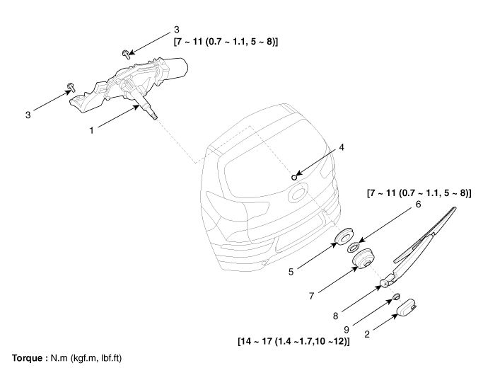

# Desumidificador Traseiro / Lavador de Para-brisa — Componentes e localização

[Home](../../index.md) / [Manual de Serviço e Reparo](../sportage-482.md) / [Sistema Elétrico do Corpo](sportage-984.md) / [Desumidificador Traseiro / Lavador de Para-brisa](sportage-1110.md) / Componentes e localização

## Diagrama

## Legenda

| Nº | Componente |
| --- | --- |
| 1 | Módulo do motor do limpador traseiro |
| 2 | Capa do farol |
| 3 | Parafuso de montagem do motor do limpador traseiro |
| 4 | Buraco de montagem do motor do limpador traseiro |
| 5 | Capa do pano |
| 6 | Parafuso hexagonal |
| 7 | Capa |
| 8 | Braço e lâmina do limpador traseiro |
| 9 | Parafuso do braço do limpador traseiro |
