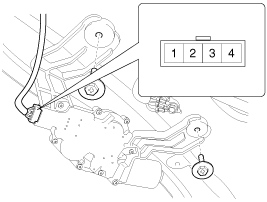
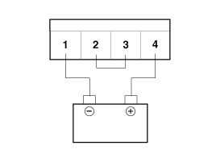
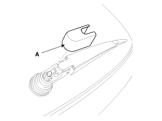
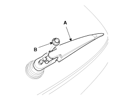
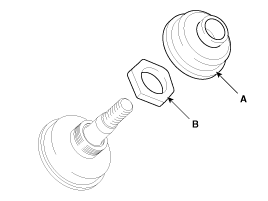
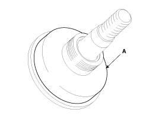
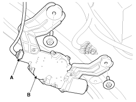
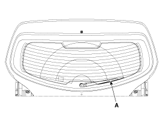

# Kia Sportage: Motor de Despejo Traseiro: Procedimentos de Reparo

[Home](../../index.md) / [Manual de Serviço e Reparo do Kia Sportage SL](../sportage-482.md) / [Sistema Elétrico do Corpo](sportage-984.md) / [Despejo e Lavagem Traseira](sportage-1110.md) / Procedimentos de Reparo do Motor de Despejo Traseiro

## Inspeção

Motor de Despejo Traseiro

1. Remova o conectador 4P do motor de despejo traseiro.

2. Conecte as barras positiva (+) e negativa (-) do bocal à terminais 2 e 1, respectivamente.

3. Verifique se o motor opera normalmente. Substitua o motor se operar de forma anormal.

   

   | No | Descrição | No | Descrição |
   | --- | --- | --- | --- |
   | 1 | GND | 3 | Estacionamento |
   | 2 | Interruptor | 4 | IGN(+) |

Verificação da Operação Automática de Parada

1. Operacionalize o motor em velocidade baixa usando o controle do manopla.

2. Pare a operação do motor em qualquer lugar, exceto na posição off, desconectando o terminal 2.

3. Conecte os terminais 2 e 3.

4. Conecte a barra positiva (+) do bocal à terminal 4 e a barra negativa (-) à terminal 1.

5. Verifique se o motor para de funcionar na posição off.

   

## Remoção

1. Desconecte a tampa do despejo traseiro (A).

   

2. Remova o braço e a lâmina do despejo traseiro (A) após remover o parafuso do braço do despejo traseiro (B).

   

3. Remova a capa do despejo traseiro (A) e o parafuso HEX (B).

   

4. Remova a tampa do amortecedor (A).

   

5. Abra o porta-malas e remova o acabamento do porta-malas.

   (Consulte o grupo BD - "Porta-malas")

6. Desconecte o conectador do motor de despejo traseiro (A) e remova o motor de despejo traseiro (B) após desafinar os parafusos (2EA).

   

## Instalação

1. Instale a montagem do motor de despejo traseiro.

   ```
   Torque de aperto do parafuso :
   7 ~ 11 N.m (0,7 ~ 1,1 kgf.m, 5 ~ 8 lbf.ft)
   ```

   > **Nota**
   >
   > - Não reutilize a borracha do amortecedor se estiver danificada.

2. Instale o acabamento do porta-malas.

   (Consulte o grupo BD - "Porta-malas")

3. Insira a tampa do amortecedor e o parafuso HEX.

   ```
   Torque de aperto :
   7 ~ 11 N.m (0,7 ~ 1,1 kgf.m, 5 ~ 8 lbf.ft)
   ```

4. Instale o braço e a lâmina do despejo traseiro alinhando com a linha mais baixa do defroste traseiro preto (A).

   

5. Instale o braço do despejo traseiro e o parafuso do braço do despejo traseiro.

   ```
   Torque de aperto do parafuso :
   14 ~ 17 N.m (1,4 ~ 1,7 kgf.m, 10 ~ 12 lbf.ft)
   ```
