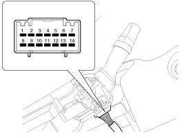
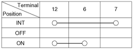
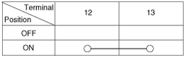

# Kia Sportage: Interruptor de Lavador de Trás: Procedimentos de Reparo

[Home](../../index.md) / [Manual de Serviço e Reparo do Kia Sportage SL](../sportage-482.md) / [Sistema Elétrico do Corpo](sportage-984.md) / [Lavador e Limpador Traseiro](sportage-1110.md) / Procedimentos de Reparo do Interruptor de Lavador de Trás

## Inspeção

Verifique a continuidade entre os terminais ao operar o interruptor de limpador e lavador. Se não estiver na condição normal, substitua o interruptor de limpador e lavador.

Interruptor de Limpador Traseiro

Interruptor de Lavador Traseiro

