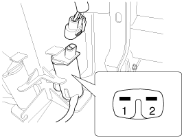
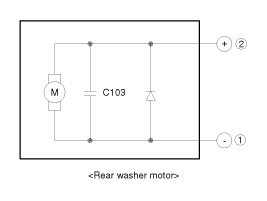

# Kia Sportage: Motor de Lavagem Traseira: Procedimentos de Reparo

[Home](../../index.md) / [Manual de Serviço e Reparo do Kia Sportage SL](../sportage-482.md) / [Sistema Elétrico do Corpo](sportage-984.md) / [Limpador e Lavador Traseiro](sportage-1110.md) / Motor de Lavagem Traseira: Procedimentos de Reparo

## Inspeção

1. Conecte o motor de lavagem ao tanque de reservatório e preencha o tanque de reservatório com água.

   > **Nota**
   >
   > - Antes de preencher o tanque de reservatório com água, verifique o
   filtro para material estranho ou contaminação. Se necessário, limpe o
   filtro.

2. Remova a capa do bumbô frontal.

   (Consulte o grupo BD - "Bumbô frontal")

3. Conecte as correias positivas (+) e negativas (-) das baterias aos terminais 2 e 1, respectivamente, para verificar se o motor de lavagem funciona e a água é bombada.

4. Verifique que o motor opera normalmente.

   Substitua o motor se ele operar de forma anormal.

   

   | N° | Descrição | N° | Descrição |
   | --- | --- | --- | --- |
   | 1 | GND | 2 | Lavagem (+) |

   
