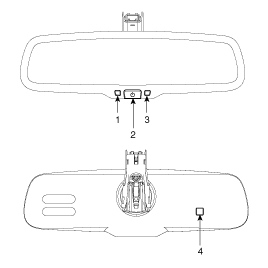
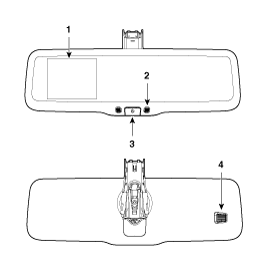

# Kia Sportage: Descrição e Operação

[Início](../../index.md) / [Manual de Serviço e Reparo do Kia Sportage SL](../sportage-482.md) / [Sistema Elétrico do Corpo](sportage-984.md) / [Espelho Retrovisor Interno Cromoelétrico](sportage-1115.md) / Descrição e Operação

## Descrição

O ECM (Electro Cromático do Retrovisor Interno) é usado para
diminuir a luz refletida de um veículo atrás durante a noite, para que o usuário não seja ofuscado pela luz. O sensor frontal detecta a luminosidade do ambiente, enquanto o sensor traseiro detecta a intensidade da luz refletida para ajustar a reflexividade do retrovisor no intervalo de 7~85%. No entanto, quando a marcha ré é engatada, o sistema para de funcionar.

1. O sensor frontal verifica se a luminosidade do ambiente é baixa o suficiente para que o retrovisor possa executar sua função.

2. O sensor traseiro detecta a ofuscamento da luz refletida de um veículo atrás.

3. O ECM é escurecido ao nível determinado pelo
   sensor traseiro. Quando o ofuscamento não é mais detectado, o retrovisor para de funcionar.

   1. Indicador LED

   2. Interruptor ON/OFF

   3. Sensor traseiro

   4. Sensor frontal

   

Retrovisor de Exibição em Ré

Descrição

O sistema de câmera de visão traseira, localizado na porta traseira,
fornece uma imagem de vídeo (que aparece no retrovisor) da área atrás do veículo. Ele adiciona assistência ao motorista enquanto estiver reversando ou estacionando em ré.

Para usar o sistema de câmera de visão traseira, coloque a transmissão em
 R (Ré); uma imagem será exibida na parte esquerda do retrovisor. A área exibida na tela pode variar de acordo com a orientação do veículo e/ou condições de tráfego.

1. Exibição da câmera traseira

2. Sensor traseiro

3. Botão de energia

4. Sensor frontal

Use os espelhos laterais e o retrovisor de visão traseira para obter uma cobertura melhor nos lados e trás do veículo. Ao sair da ré e entrar em qualquer outra marcha, a imagem permanecerá ligada por alguns segundos antes de se apagar para auxiliar no estacionamento ou na montagem de um remolho.

A lente da câmera para o sistema de câmera de visão traseira está localizada na porta traseira, próxima ao gatilho da porta traseira. Manter a lente limpa garante que a imagem de vídeo permaneça clara e não distorcida. Limpe a lente com um pano macio e sem fios e um limpador não abrasivo.

> **Nota**
>
> - Se a imagem do sistema de câmera de visão traseira não for clara ou parecer distorcida, pode estar coberta por gotas d'água, neve, lama ou qualquer outra substância. Se isso ocorrer, limpe a lente da câmera antes de usar o sistema de câmera de ré.

> **Aviso**
>
> - O sistema de câmera de visão traseira é um dispositivo de auxílio na reversão complementar que ainda requer que o motorista o use em conjunto com o retrovisor de visão traseira e os espelhos laterais para cobertura máxima.

> **Aviso**
>
> - Objetos que estejam próximos a qualquer canto do para-choque ou sob o para-choque podem não ser vistos na tela devido à cobertura limitada do sistema de câmera de visão traseira.

> **Aviso**
>
> - Retifique com a menor velocidade possível, pois velocidades mais altas podem limitar seu tempo de reação para parar o veículo.

> **Aviso**
>
> - Não use o sistema de câmera de visão traseira com a porta traseira aberta.

Se o final do veículo for atingido ou danificado, então verifique com seu concessionário autorizado para que seu sistema de vídeo traseiro seja verificado para cobertura e operação corretas.

Uso à noite e em áreas escurecidas

À noite ou em áreas escurecidas, o sistema de câmera de visão traseira depende da iluminação das luzes de ré para produzir uma imagem. Portanto, é necessário que ambas as luzes de ré estejam funcionando para obter uma imagem clara na escuridão. Se alguma das luzes não estiver funcionando, pare de usar o sistema de câmera de visão traseira, pelo menos na escuridão, até que a luz(es) sejam substituídas e funcionem.

## Função de Dimensão Automática

Para proteger sua visão durante a condução noturna, o espelho
irá automaticamente diminuir a luminosidade ao detectar reflexos dos veículos
que o seguem. A função de dimensão automática pode ser controlada pelo botão Dimming
ON/OFF:

1. Pressionando e segurando o botão de controle da funcionalidade por mais
    3 do que 6 segundos desativa a função de dimensão automática, indicada pelo LED de Indicador de Status verde se apagando.

2. Pressionando e segurando o botão de controle da funcionalidade novamente por
   mais 3 do que 6 segundos ativa a função de dimensão automática, indicada pelo LED de Indicador de Status verde se acendendo.

   > **Nota**
   >
   > - O espelho retorna à posição "ON" a cada vez que o veículo é ligado.
