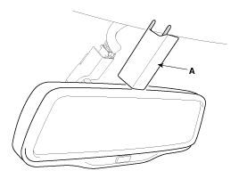
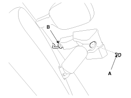
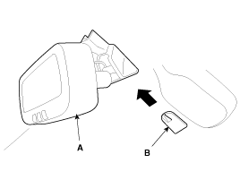

# Kia Sportage: Procedimentos de Reparo

[Home](../../index.md) / [Manual de Serviço e Reparo do Kia Sportage SL](../sportage-482.md) / [Sistema Elétrico do Corpo](sportage-984.md) / [Espelho Interno Electro Cromático](sportage-1115.md) / Procedimentos de Reparo

## Inspeção

Verifique conforme o procedimento abaixo para verificar se a função do ECM está normal.

1. Coloque a chave do veículo no位置
assistant
## Inspeção

Verifique conforme o procedimento abaixo para verificar se a função do ECM está normal.

1. Coloque a chave do veículo na posição "ON".

2. Cobre o sensor frontal.

3. Dirija uma luz para o sensor traseiro.

4. O ECM deve escurecer assim que o sensor traseiro detectar a luz.

   > **Nota**
   >
   > - Se este teste for realizado durante o dia, o ECM pode escurecer assim que o sensor frontal for coberto.

5. Quando o câmbio estiver em ré, o ECM não deve escurecer.

   Ao direcionar luzes para ambos os sensores frontal e traseiro, o ECM não deve escurecer.

## Remoção

1. Remova a capa de conexão do espelho (A).

   

2. Remova a viga de fixação do espelho (A) e a conexão (B).

   

3. Remova o espelho (A) puxando para cima na direção do seta.

   > **Nota**
   >
   > - Certifique-se de não danificar o suporte de fixação (B) ao remover o espelho.

   

## Instalação

1. Instale o espelho, garantindo que o suporte de fixação não seja danificado.

2. Instale a capa de conexão do espelho após reconectar a conexão e apertar o parafuso.
