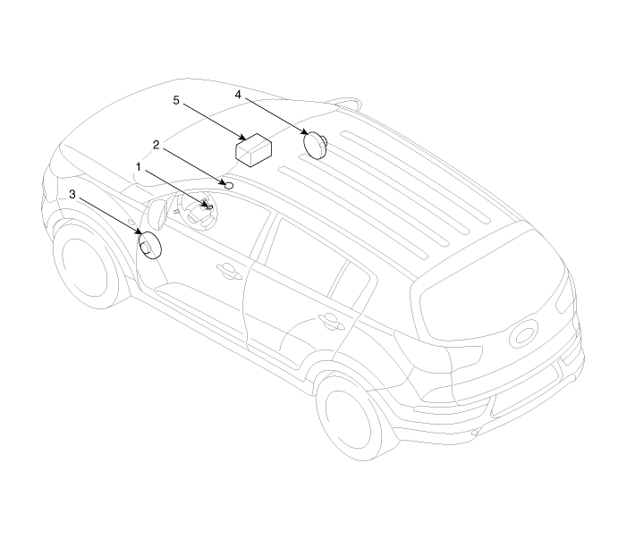

# Kia Sportage: Componentes e Localização dos Componentes

[Home](../../index.md) / [Manual de Serviço e Reparo do Kia Sportage SL](../sportage-482.md) / [Sistema Elétrico do Corpo](sportage-984.md) / [Sistema de Chamada sem Fio](sportage-1119.md) / Componentes e Localização dos Componentes

## Componentes

| 1. Interruptor de chamada sem fio 2. Microfone 3. Altavoz frontal esquerdo | 4. Altavoz frontal direito 5. Unidade de áudio (controle sem fio) |
| --- | --- |

? Não há conector de chamada sem fio. Este sistema suporta Bluetooth (sistema sem fio).
