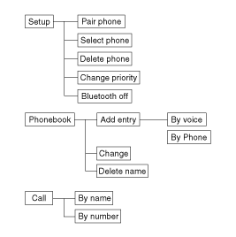

# Kia Sportage: Descrição e Operação

[Home](../../index.md) / [Manual de Serviço e Reparo do Kia Sportage SL](../sportage-482.md) / [Sistema Elétrico do Corpo](sportage-984.md) / [Sistema Hands Free](sportage-1119.md) / Descrição e Operação

## Função

Sistema de Áudio Bluetooth

Bluetooth

Você pode usar um dispositivo Bluetooth no seu carro para fazer uma
chamada telefônica sem as mãos ou para transmitir música para os altifalantes do seu carro (através
deste Unidade Central). Esta Unidade Central suporta conexões HFP, A2DP e AVRCP.

Perfil de Distribuição de Áudio Avançado (A2DP)

Este perfil define como áudio de alta qualidade (estéreo ou mono) pode ser transmitido de um dispositivo para outro através de uma conexão Bluetooth. Por exemplo: música transmitida de um telefone móvel para um auricular sem fio ou som automotivo.

Perfil de Controle Remoto de Áudio/Vídeo (AVRCP)

Este perfil foi projetado para fornecer uma interface padrão para controlar TVs, equipamentos de som de alta fidelidade, etc., permitindo que um único controle remoto (ou outro dispositivo) controle todos os equipamentos de áudio/vídeo aos quais o usuário tem acesso. Pode ser usado em conjunto com A2DP ou VDP.

Perfil de Chamada Sem Mão (HFP)

Este é comumente usado para permitir que kits sem mão do carro comuniquem-se com telefones móveis no carro.

Notas para telefones móveis

Alguns recursos (por exemplo, o início da reconhecimento de voz) não
são suportados por todos os telefones móveis. Não podemos garantir que todos os recursos
descritos serão suportados por todos os telefones móveis com Bluetooth.

Novo dispositivo

Esta função permite adicionar um novo telefone à lista de Dispositivos Bluetooth da Unidade Central. Máximo de 5 dispositivos podem ser adicionados à lista.
Se a lista estiver cheia, o dispositivo mais antigo será substituído pelo novo dispositivo Bluetooth, com base na data mais recente de parada.

Ativação da Reconhecimento de Voz

| • | O motor de reconhecimento de voz contido no Sistema Bluetooth pode ser ativado nas seguintes condições: - Ativação pelo Botão A ativação do sistema de reconhecimento de voz ocorrerá quando o botão for pressionado e após o som de um bip. - Escuta ativa O sistema de reconhecimento de voz será ativo por um período de
tempo quando o sistema de Reconhecimento de Voz solicitou uma resposta do cliente. |
| --- | --- |

| • | O sistema pode reconhecer dígitos individuais de zero a nove, enquanto números maiores que dez não serão reconhecidos. |
| --- | --- |

| • | Se o comando não for reconhecido, o sistema anunciará "Pardon" ou "Sem sinal de voz do microfone". (Sem resposta) |
| --- | --- |

| • | O sistema cancelará o modo de reconhecimento de voz nas seguintes situações: Quando pressionar o botão e dizer cancelar após o bip. Quando não estiver fazendo uma chamada e pressionar o botão. Quando o reconhecimento de voz falhar 3 vezes consecutivas. |
| --- | --- |

| • | Em qualquer momento, se você disser "help", o sistema anunciará quais comandos estão disponíveis. |
| --- | --- |

Árvore de menu

