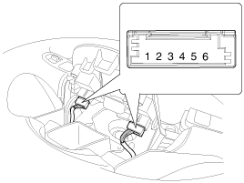
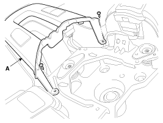
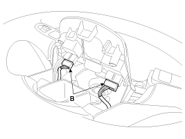

# Kia Sportage: Hands Free Switch: Procedimentos de Reparo

[Home](../../index.md) / [Manual de Serviço e Reparo do Kia Sportage SL](../sportage-482.md) / [Sistema Elétrico do Corpo](sportage-984.md) / [Sistema Hands Free](sportage-1119.md) / Procedimentos de Reparo do Hands Free Switch

## Inspeção

1. Verifique a resistência do interruptor do controle remoto hands free entre os terminais No.3 e No.4 em cada posição do interruptor.

   

   [Ligar e Desligar]

   | Interruptor | Conector terminal | Resistência (±5%) | Tensão de saída (±0.22V) |
   | --- | --- | --- | --- |
   | Ligar | 3 - 4 (Esquerda) | 40.91 k? | 4V |
   | Desligar | 3 - 4 (Esquerda) | 18.91 k? | 4.5V |

   [Voz]

   | Interruptor | Conector terminal | Resistência (±5%) | Tensão de saída (±0.22V) |
   | --- | --- | --- | --- |
   | Voz | 4 - 5 (Direita) | 10.71 k? | 3.5V |

## Remoção

1. Remova o módulo do airbag do motorista.

   (Consulte o grupo RT - "Módulo do airbag")

2. Remova o volante.

   (Consulte o grupo ST - "Coluna e eixo do volante")

3. Remova o bezel inferior do volante (A) após desafinar 2 parafusos e o conector (B).

   

   

4. Remova o interruptor do controle remoto hands free.

## Instalação

1. Instale o interruptor do controle remoto hands free no bezel do volante.

2. Instale o volante e o bezel.

3. Reconecte o conector do controle remoto hands free e os conectores do airbag.

   > **Nota**
   >
   > - Certifique-se de que o conector do interruptor esteja conectado corretamente.

4. Instale o módulo do airbag do motorista.
