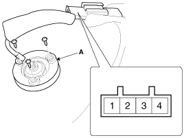
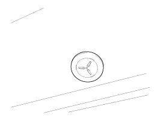
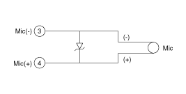

# Kia Sportage: Mic Sem Fio: Procedimentos de Reparo

[Home](../../index.md) / [Manual de Serviço e Reparo do Kia Sportage SL](../sportage-482.md) / [Sistema Elétrico do Corpo](sportage-984.md) / [Mic Sem Fio](sportage-1119.md) / Procedimentos de Reparo do Mic Sem Fio

## Inspeção

1. Desconecte o terminal negativo (-) da bateria.

2. Remova o acabamento do teto.

   (Consulte o grupo BD - "Acabamento do teto")

3. Remova o mic sem fio (A) após soltar o conector e as parafusos (3 unidades) do teto.

   

   

4. Verifique a continuidade do mic entre os terminais.

   
