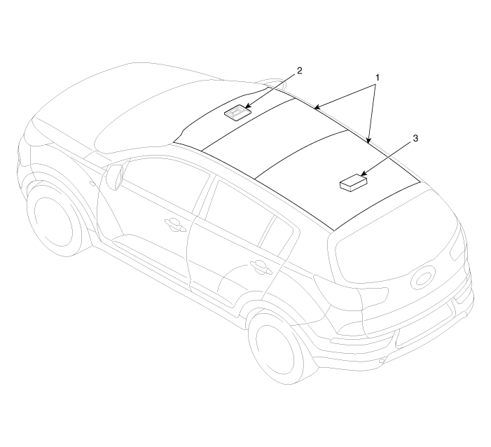

# Kia Sportage: Componentes e Localização dos Componentes

[Home](../../index.md) / [Manual de Serviço e Reparo do Kia Sportage SL](../sportage-482.md) / [Sistema Elétrico do Corpo](sportage-984.md) / [Teto Panorâmico](sportage-1126.md) / Componentes e Localização dos Componentes

## Localização dos Componentes

| 1. Teto Panorâmico 2. Interruptor do Teto Panorâmico | 3. Motor e Controlador do Teto Panorâmico |
| --- | --- |

## Componentes

| 1. Montagem do Teto Panorâmico 2. Montagem do Membro de Impacto do Teto Panorâmico 3. Montagem do Mecanismo do Teto Panorâmico 4. Montagem do Painel de Vidro Anterior do Teto Panorâmico 5. Montagem do Painel de Vidro Móvel do Teto Panorâmico | 6. Montagem do Defletor do Teto Panorâmico 7. Montagem do Motor do Teto Panorâmico 8. Dispositivo Central do Teto Panorâmico 9. Membro de Impacto |
| --- | --- |
