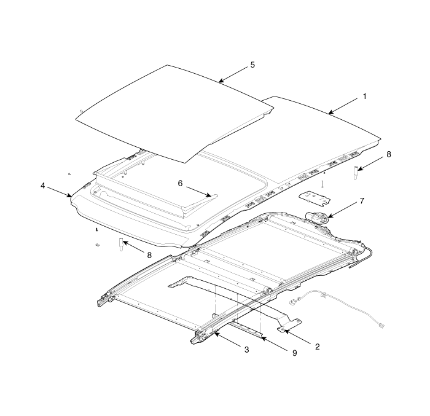

# Teto Panorâmico — Componentes e localização

[Home](../../index.md) / [Manual de Serviço e Reparo](../sportage-482.md) / [Sistema Elétrico do Corpo](sportage-984.md) / [Teto Panorâmico](sportage-1126.md) / Componentes e localização

## Diagrama — Localização

## Legenda — Localização

| Nº | Componente |
| --- | --- |
| 1 | Teto Panorâmico |
| 2 | Interruptor do Teto Panorâmico |
| 3 | Motor e Controlador do Teto Panorâmico |

## Diagrama — Componentes

## Legenda — Componentes

| Nº | Componente |
| --- | --- |
| 1 | Montagem do Teto Panorâmico |
| 2 | Montagem do Membro de Impacto do Teto Panorâmico |
| 3 | Montagem do Mecanismo do Teto Panorâmico |
| 4 | Montagem do Painel de Vidro Anterior do Teto Panorâmico |
| 5 | Montagem do Painel de Vidro Móvel do Teto Panorâmico |
| 6 | Montagem do Defletor do Teto Panorâmico |
| 7 | Montagem do Motor do Teto Panorâmico |
| 8 | Dispositivo Central do Teto Panorâmico |
| 9 | Membro de Impacto |
