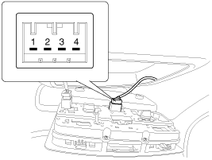
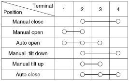

# Kia Sportage: Panoramaroof Switch: Procedimentos de Reparo

[Início](../../index.md) / [Manual de Serviço e Reparo do Kia Sportage SL](../sportage-482.md) / [Sistema Elétrico do Corpo](sportage-984.md) / [Panoramaroof](sportage-1126.md) / Procedimentos de Reparo do Interruptor de Panoramaroof

## Inspeção

1. Desconecte o terminal negativo (-) da bateria.

2. Remova a montagem do lustre do painel superior.

   (Consulte o grupo BD - "Trim do teto")

3. Verifique a continuidade entre os terminais. Se a continuidade não for conforme o especificado, substitua o interruptor do teto panorâmico.

   

   
