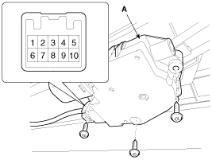
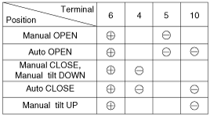
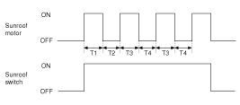

# Kia Sportage: Panoramaroof Motor: Procedimentos de Reparo

[Home](../../index.md) / [Manual de Serviço e Reparo do Kia Sportage SL](../sportage-482.md) / [Sistema Elétrico do Corpo](sportage-984.md) / [Panoramaroof](sportage-1126.md) / Procedimentos de Reparo do Motor do Panoramaroof

## Troca

1. Desconecte o terminal negativo (-) da bateria.

2. Remova o acabamento do teto.

   (Consulte o grupo BD - "Acabamento do teto")

3. Remova o motor do panoramaroof (A) após desconectar o conectador (10 pinos).

   

4. Tercele os terminais conforme a tabela abaixo e verifique se o panoramaroof opera conforme a tabela.

   

5. Realize esses testes de entrada no conectador do motor do panoramaroof.

   Se qualquer teste indicar um problema, encontre e corrija a causa, e reabra o sistema.

   Se todos os testes de entrada forem OK, o motor do panoramaroof deve estar danificado; substitua-o.

   | Terminal | Condição de teste | Teste : Resultado desejado |
   | --- | --- | --- |
   | 3 | IG2 ON | Verifique a tensão em relação ao chassi : Deve haver a tensão da bateria |
   | 1 | Em todas as condições | Verifique a continuidade em relação ao chassi : Deve haver continuidade. |
   | 6 | Em todas as condições | Verifique a tensão em relação ao chassi : Deve haver a tensão da bateria. |

6. Realize esses testes de entrada no conectador do console do panoramaroof

   Se qualquer teste indicar um problema, encontre e corrija a causa, e reabra o sistema.

   Se todos os testes de entrada forem OK, o motor do panoramaroof deve estar danificado; substitua-o.

   | Terminal | Condição de teste | Teste : Resultado desejado |
   | --- | --- | --- |
   | 3 | IG2 ON | Verifique a tensão em relação ao chassi : Deve haver a tensão da bateria |
   | 1 | Em todas as condições | Verifique a continuidade em relação ao chassi : Deve haver continuidade. |
   | 6 | Em todas as condições | Verifique a tensão em relação ao chassi : Deve haver a tensão da bateria. |

Resetando o Panoramaroof

Cada vez que a bateria do veículo for desconectada ou descarregada,
ou você usar o manivela de emergência para operar o Panoramaroof, você terá que
reinicializar seu sistema de panoramaroof conforme segue :

1. Coloque a chave do ignição na posição ON e então feche completamente o panoramaroof.

2. Libere o lembrete de controle do panoramaroof.

3. Pressione e segure o botão FECHAR por mais de 10 segundos até que o teto solar tenha se movido ligeiramente.

4. Libere o lembrete de controle do panoramaroof.

5. Pressione e segure o botão FECHAR novamente até que o teto solar faça o seguinte;

   | • | Inclinado > Aberto por deslizamento > Fechado por deslizamento, em seguida, libere o lembrete. |
   | --- | --- |

6. O procedimento de reinicialização do sistema de panoramaroof foi concluído.

Proteção do Motor Sobreaquecido

Para proteger o motor do panoramaroof sobreaquecido por operação contínua do motor, o ECU do panoramaroof controla o tempo de execução e o tempo de resfriamento do motor conforme segue;

1. O ECU do panoramaroof detecta o tempo de execução do motor

2. O motor pode ser operado continuamente durante o 1º tempo de execução (120 ± 10s.).

3. O motor que foi operado continuamente para o 1º tempo de execução (120 ± 10s.) para de operar.

4. E então o motor não é operado durante o 1º tempo de resfriamento (18 ± 2s.).

5. O motor é operado durante o 2º tempo de execução (10 ± 2s.) durante a operação contínua do motor após o 1º tempo de resfriamento (18 ± 2s.)

6. Motor que opera continuamente para de operar após o 2º Tempo de Funcionamento (10 ± 2s.)

7. Motor não opera durante o 2º Tempo de Resfriamento (18 ± 2s.).

8. Motor repete o 2º Tempo de Funcionamento e o 2º Tempo de Resfriamento durante a operação contínua do motor.

   | – | Se o motor não opera continuamente, o Tempo de Funcionamento limitado para proteger o motor aquecido demais é aumentado. |
   | --- | --- |

   | – | O Tempo de Funcionamento do motor é inicializado para "0" se a bateria ou fusível for reconectado após ter sido desligado, descarregado ou quebrado. |
   | --- | --- |

T1 : 120 ± 10s., T2 : 18 ± 2s.,

T3 : 10 ± 2s., T4 : 18 ± 2s.
