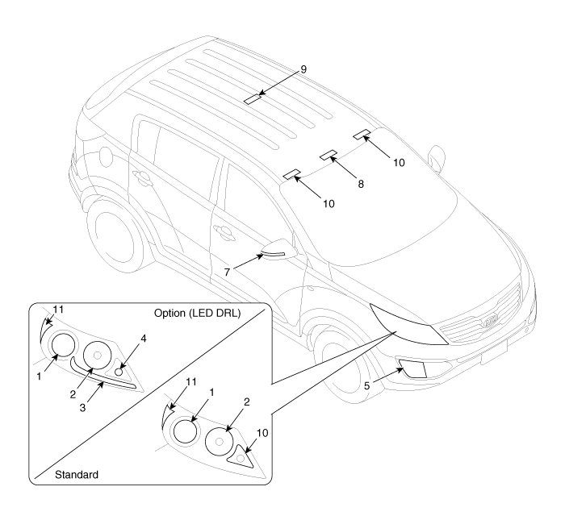
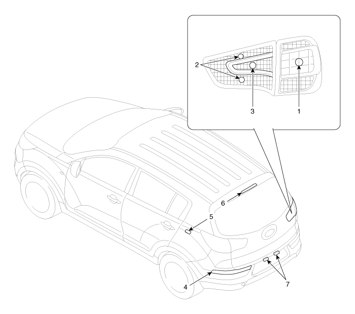

# Kia Sportage: Componentes e Localização dos Componentes

[Home](../../index.md) / [Manual de Serviço e Reparo do Kia Sportage SL](../sportage-482.md) / [Sistema Elétrico do Corpo](sportage-984.md) / [Sistema de Iluminação](sportage-1131.md) / Componentes e Localização dos Componentes

## Localização dos Componentes (1)

| 1. Farol baixo 2. Farol alto 3. DRL & LED de posição 4. Farol de sinalização do lado frontal 5. Farol de neblina frontal 6. Sinalizador de direção do espelho retrovisor (LED) | 7. Lampada do teto 8. Lampada do compartimento 9. Lampada do porta-maquiagem 10. Sinalizador de direção & de posição 11. Sinalizador de marcação latera |
| --- | --- |

## Localização dos Componentes (2)

| 1. Farol traseiro/parada 2. Sinalizador de posição 3. Lampada de ré 4. Sinalizador de direção traseiro | 5. Lampada do bagageiro 6. Sinalizador de parada elevado 7. Lampada do número do licenciamento |
| --- | --- |
