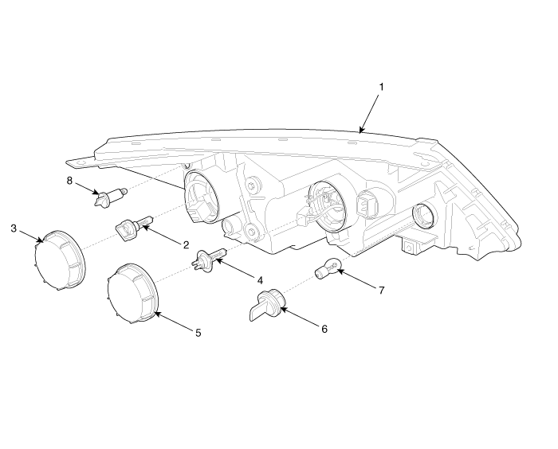

# Faróis — Componentes e localização

[Home](../../index.md) / [Manual de Serviço e Reparo](../sportage-482.md) / [Sistema Elétrico do Corpo](sportage-984.md) / [Sistema de Iluminação](sportage-1131.md) / Componentes e localização

## Diagrama

## Legenda

| Nº | Componente |
| --- | --- |
| 1 | Conjunto do farol lente e caixa |
| 2 | Bulbo do farol (baixo) |
| 3 | Capa de poeira |
| 4 | Bulbo do farol (alto) |
| 5 | Capa de poeira |
| 6 | Conector da luz de sinal de direção/freio |
| 7 | Bulbo da luz de sinal de direção/freio |
| 8 | Bulbo da marca lateral |
