# Kia Sportage: Faróis: Procedimentos de Reparo

[Home](../../index.md) / [Manual de Serviço e Reparo do Kia Sportage SL](../sportage-482.md) / [Sistema Elétrico do Corpo](sportage-984.md) / [Sistema de Iluminação](sportage-1131.md) / Procedimentos de Reparo dos Faróis

## Remoção

> **Cuidado**
>
> - Os faróis ficam muito quentes durante o uso; não toque neles ou em qualquer peça de fixação imediatamente após serem desligados.

> **Observação**
>
> - A lâmpada do farol não deve ser removida do conjunto do farol até o momento de instalar uma nova lâmpada.
> - Remover a lâmpada por um período prolongado pode afetar o desempenho da lâmpada do farol.
> - Contaminantes podem entrar no conjunto do farol e se depositar no lente e no refletor.
> - Nunca ligue os faróis com a lâmpada removida do conjunto do farol.

1. Desconecte o terminal negativo (-) da bateria.

2. Desloque os parafusos de montagem (3UN) do farol. Desconecte o conectador.

   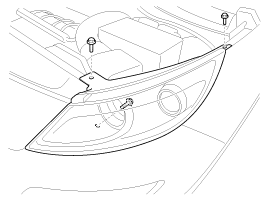

3. Remova os parafusos e parafusos instalados na cobertura superior do bumbô frontal (A).

   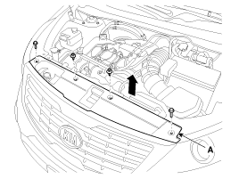

4. Remova o conjunto do farol (B) espalhando a grade do radiador (A).

   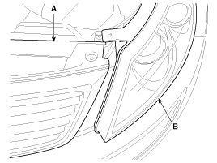

## Instalação

1. Instale as lâmpadas do farol.

2. Reassemble as coberturas das lâmpadas do farol.

3. Reassemble o conjunto do farol após conectar o conectador da lâmpada.

## Troca

Lâmpada do Farol (Baixa)

1. Desligue o interruptor do farol.

2. Remova a capa de sujeira. Vire a lâmpada no sentido horário e remova-a.

   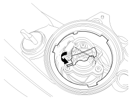

   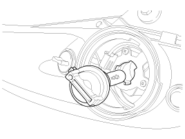

3. A instalação é o contrário da remoção.

Lâmpada do Farol (Alta)

1. Desligue o interruptor do farol.

2. Remova a capa de cobertura.

3. Desconecte o conectador (A) e a pinça (B), remova a lâmpada.

   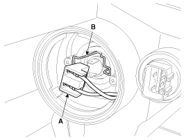

4. A instalação é o contrário da remoção.

Lâmpada de Sinal de Girassol

1. Desligue o interruptor do farol.

2. Vire a base da lâmpada no sentido horário para remover a lâmpada de sinal de girassol (A).

   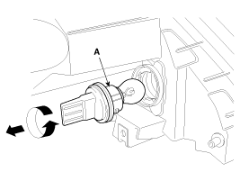

3. A instalação é o contrário da remoção.

Lâmpada de Marcação Lateral

1. Vire a lâmpada (A) no sentido horário e remova-a.

   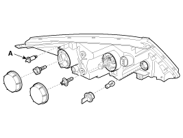

2. A instalação é o contrário da remoção.

## Ajuste

Instruções de Alineação da Luz de Frente

A luz de frete deve ser alinhada com o equipamento adequado para ajustar a projeção e de acordo com as instruções do fabricante do equipamento.

> **Nota**
>
> - Se existirem regulamentos relevantes para a alinhamento da luz de frete na área onde o veículo será utilizado, ajuste de acordo com esses requisitos.

Para ajustar a alinhamento da luz de frete, alternadamente girar o mecanismo de ajuste. Se o equipamento para ajustar a projeção não estiver disponível, prosseguir conforme os seguintes passos:

1. Inflar os pneus para a pressão especificada e remover qualquer carga do veículo, exceto o condutor, pneu de reparo e ferramentas.

2. O veículo deve ser colocado em um piso plano.

3. Desenhar linhas verticais (linhas verticais passando pelos centros das luzes de frete) e uma linha horizontal (linha horizontal passando pelo centro das luzes de frete) na tela.

4. Com a luz de frete e a bateria em condições normais, alinhar as luzes de frete para que a parte mais brilhante caia nas linhas verticais.

   Realizar o ajuste horizontal (A) na luz baixa usando a roda de ajuste.

   | (1) | Tipo Geral |
   | --- | --- |

Alineação das Luzes de Neblina Frente

As luzes de neblina da frente devem ser alinhadas de maneira semelhante ao alinhamento das luzes de frete.

Com as luzes de neblina da frente e a bateria em condições normais, alinhar as luzes de neblina da frente girando o mecanismo de ajuste (A).

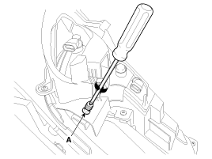

Ponto de Alineação da Luz de Frete e Luz de Neblina Frente

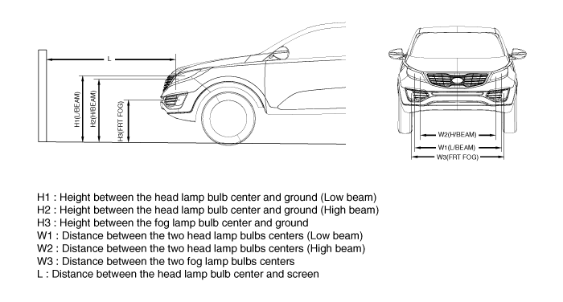

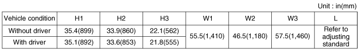

1. Tipo Geral

   | – | Ligar a luz baixa sem condutor a bordo. |
   | --- | --- |

   | – | A linha de corte deve ser projetada no intervalo permitido (área sombreada) mostrado na imagem. |
   | --- | --- |

   | – | Se o dispositivo de alinhamento da luz de frete estiver equipado, ajustar o interruptor do dispositivo de alinhamento da luz de frete para a posição 0. |
   | --- | --- |

   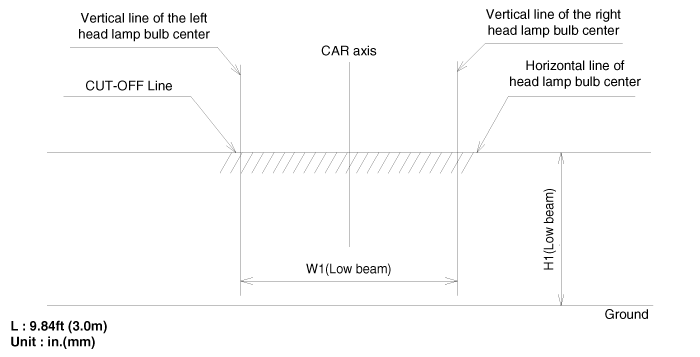

2. Ligar as luzes de neblina da frente com o condutor sentado no veículo.

   A linha de corte deve ser projetada no intervalo permitido mostrado na imagem.

   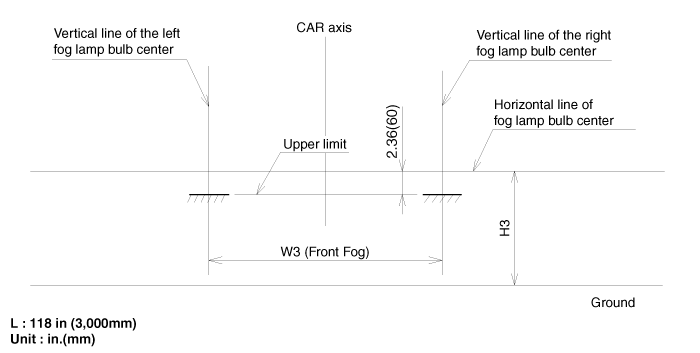
