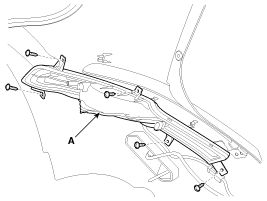
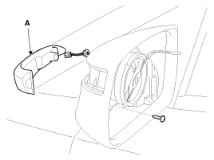

# Kia Sportage: Lampada de Sinalização de Girassol: Procedimentos de Reparo

[Home](../../index.md) / [Manual de Serviço e Reparo do Kia Sportage SL](../sportage-482.md) / [Sistema Elétrico do Corpo](sportage-984.md) / [Sistema de Iluminação](sportage-1131.md) / Procedimentos de Reparo da Lampada de Sinalização de Girassol

## Remoção

Lampada de Sinalização de Girassol Traseira

1. Desconecte o terminal negativo (-) da bateria.

2. Remova o para-choque traseiro.

   (Consulte o grupo BD - "Para-choque Traseiro")

3. Desconecte o conectador. Remova a lampada de sinalização traseira (A) após soltar 5 parafusos.

   

4. Substitua a lâmpada (A) da lampada de sinalização traseira.

   ? Se a substituição for apenas da lâmpada, o trabalho pode ser realizado sem a remoção do para-choque traseiro.

Lampada de Sinalização de Girassol do Retrovisor do Porta-malas

1. Desconecte o terminal negativo (-) da bateria.

2. Remova o retrovisor do suporte do retrovisor.

   Cuide para não danificar o gancho.

3. Remova a lampada de sinalização de girassol do retrovisor (A) após desmontar o parafuso e o conectador.

   

## Instalação

Lampada de Sinalização de Girassol Traseira

1. Instale a lâmpada na montagem da lampada de sinalização traseira.

2. Instale a lampada de sinalização traseira no para-choque traseiro.

Lampada de Sinalização de Girassol do Retrovisor do Porta-malas

1. Instale a lampada de sinalização de girassol do retrovisor no retrovisor.

2. Instale o retrovisor.

3. Conecte o terminal da bateria (-).
