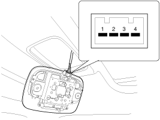
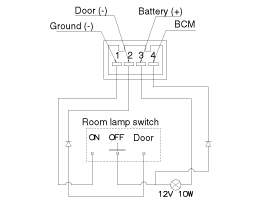
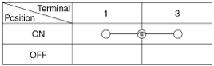
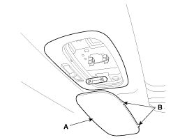
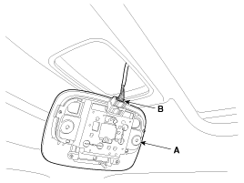

# Kia Sportage: Lampagem Interna: Procedimentos de Reparo

[Home](../../index.md) / [Manual de Serviço e Reparo do Kia Sportage SL](../sportage-482.md) / [Sistema Elétrico do Corpo](sportage-984.md) / [Sistema de Iluminação](sportage-1131.md) / Procedimentos de Reparo da Lampagem Interna

## Inspeção

1. Remova a conexão do conjunto da lampagem interna e verifique a continuidade entre os terminais.

   

   

   

## Remoção

1. Desconecte o terminal negativo (-) da bateria.

2. Desconecte o lente da lampagem interna (A) do conjunto da lampagem interna usando uma furadeira de bordo.

   

   > **Nota**
   >
   > - Cuide para não danificar a peça (B).

3. Desengane as varetas de fixação (2EA).

4. Remova o conjunto da lampagem interna (A) após desconectar a conexão (B).

   

## Instalação

1. Instale o conjunto da lampagem interna após conectar a conexão da lampagem.

2. Instale o lente após montar a lâmpada.
