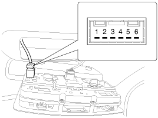
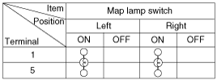
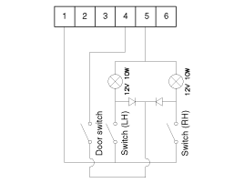
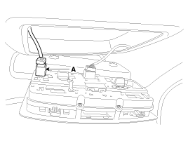
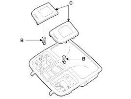

# Kia Sportage: Lampada do Painel Superior: Procedimentos de Reparo

[Home](../../index.md) / [Manual de Serviço e Reparo do Kia Sportage SL](../sportage-482.md) / [Sistema Elétrico do Corpo](sportage-984.md) / [Sistema de Iluminação](sportage-1131.md) / Procedimentos de Reparo da Lampada do Painel Superior

## Inspeção

Remova a montagem da lampada do painel superior, depois verifique a continuidade entre os terminais. Se a continuidade não for conforme o especificado, substitua o interruptor da lampada do painel superior.

| N° | Descrição | N° | Descrição |
| --- | --- | --- | --- |
| 1 | Terreno | 4 | Pêndulo (-) |
| 2 | - | 5 | Bateria (+) |
| 3 | - | 6 | - |

## Remoção

1. Desconecte o terminal negativo (-) da bateria.

2. Remova a montagem da lampada do painel superior.

   (Consulte o grupo BD - "Trim do Teto")

3. Remova a lampada do painel superior (B) após desconectar o conector do interruptor panorámico do teto (A) e o conector da lampada (A).

   

   

4. Quando se substituir apenas a lâmpada, solte a cobertura do lente (C) do teto sem remover a montagem da lampada do painel superior.

## Instalação

1. Instale as lâmpadas e conecte os conectores.

2. Instale a montagem da lampada do painel superior.
