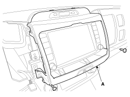
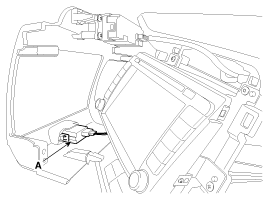
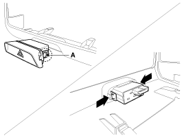
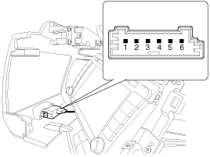
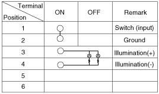

# Kia Sportage: Interruptor de Luz de Alerta: Procedimentos de Reparo

[Home](../../index.md) / [Manual de Serviço e Reparo do Kia Sportage SL](../sportage-482.md) / [Sistema Elétrico do Veículo](sportage-984.md) / [Sistema de Iluminação](sportage-1131.md) / Procedimentos de Reparo do Interruptor de Luz de Alerta

## Remoção

1. Desconecte o terminal negativo (-) da bateria.

2. Remova a painel central (A).

   (Consulte o grupo BE - "Unidade de áudio")

   

   > **Nota**
   >
   > - Cuide para não danificar e arranhar o painel central e suas partes relacionadas.
   > - Aplicar fitas protetivas no painel central e suas partes relacionadas.

3. Desconecte o conector do módulo de interruptor de luz de alerta (A).

   

4. Se o interruptor de luz de alerta não estiver conforme especificado, substitua-o com cuidado e cuide para não danificar a garrilha (A).

   

## Instalação

1. Conecte o conector do interruptor de luz de alerta.

2. Instale a montagem do interruptor de luz de alerta no painel central.

## Inspeção

1. Operacionalize o interruptor e verifique a continuidade entre os terminais com um ohmmetro.

   

   
