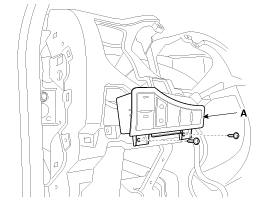
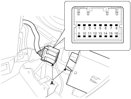
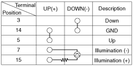

# Kia Sportage: Rheostat: Procedimentos de Reparo

[Home](../../index.md) / [Manual de Serviço e Reparo do Kia Sportage SL](../sportage-482.md) / [Sistema Elétrico do Corpo](sportage-984.md) / [Sistema de Iluminação](sportage-1131.md) / Procedimentos de Reparo do Rheostat

## Inspeção

1. Desconecte o terminal negativo (-) da bateria.

2. Remova o painel inferior do crash pad.

   (Consulte o grupo BD - "Crash pad")

3. Remova a montagem do interruptor do crash pad lateral (A) após soltar 2 parafusos.

   

   > **Nota**
   >
   > - Use luvas para proteger as mãos.

4. Remova o interruptor do crash pad lateral após desconectar os conectores (A).

   

5. Operacionalize o interruptor e verifique a continuidade entre os terminais com um ohmmetro.

   
