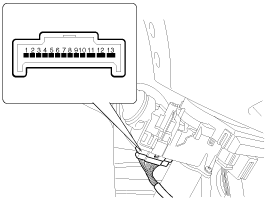
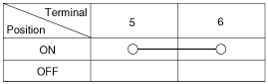
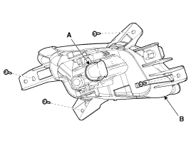

# Kia Sportage: Farol de Neblina da Dianteira: Procedimentos de Reparo

[Home](../../index.md) / [Manual de Serviço e Reparo do Kia Sportage SL](../sportage-482.md) / [Sistema Elétrico do Corpo](sportage-984.md) / [Sistema de Iluminação](sportage-1131.md) / Procedimentos de Reparo do Farol de Neblina da Dianteira

## Inspeção

Interruptor de Farol de Neblina

1. Com o interruptor de farol de neblina em cada posição, verifique a continuidade entre os terminais abaixo. Se a continuidade não for conforme especificado, substitua o interruptor multifuncional.

   

   

## Remoção

1. Desconecte o terminal negativo (-) da bateria.

2. Remova o bummper dianteiro.

   (Consulte o grupo BD - "Bummper dianteiro")

3. Remova o farol de neblina dianteiro (A) girando no sentido horário após desconectar o conectador.

   

4. Remova o farol de neblina dianteiro (B) após desengavetar as varetas.

## Instalação

1. Instale a lâmpada do farol de neblina.

2. Conecte o conectador do farol de neblina.

3. Instale o bummper dianteiro.
