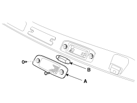

# Kia Sportage: Faróis de Circulação: Procedimentos de Reparo

[Home](../../index.md) / [Manual de Serviço e Reparo do Kia Sportage SL](../sportage-482.md) / [Sistema Elétrico do Corpo](sportage-984.md) / [Sistema de Iluminação](sportage-1131.md) / Procedimentos de Reparo dos Faróis de Circulação

## Remoção

1. Desconecte o terminal negativo (-) da bateria.

2. Remova o vidro do farol (A) e o farol de circulação (B) após soltar 2 parafusos.

   

## Instalação

1. Instale a lâmpada.

2. Instale o vidro do farol de circulação.
