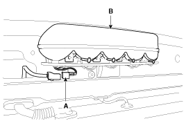

# Kia Sportage: Lanterninha de frenagem elevada: Procedimentos de reparo

[Home](../../index.md) / [Manual de Serviço e Reparo do Kia Sportage SL](../sportage-482.md) / [Sistema Elétrico do Corpo](sportage-984.md) / [Sistema de Luzes](sportage-1131.md) / Procedimentos de reparo da lanterninha de frenagem elevada

## Remoção

Lanterna de Frenagem Elevada

1. Desconecte o terminal negativo (-) da bateria.

2. Remova o acabamento do porta-malas.

   (Consulte o grupo BD - "Porta-malas")

3. Remova o alisamento do porta-malas.

   (Consulte o grupo BD - "Porta-malas")

4. Remova a montagem da lanterninha de frenagem elevada (B) após desconectar o conectador (A).

   

## Instalação

1. Instale a lanterninha de frenagem elevada e o nozzle de lavagem.

2. Instale o alisamento e o acabamento do porta-malas.
