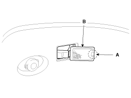

# Kia Sportage: Lâmpada do Bagageiro: Procedimentos de Reparo

[Home](../../index.md) / [Manual de Serviço e Reparo do Kia Sportage SL](../sportage-482.md) / [Sistema Elétrico do Corpo](sportage-984.md) / [Sistema de Iluminação](sportage-1131.md) / Procedimentos de Reparo da Lâmpada do Bagageiro

## Remoção

1. Desconecte o terminal negativo (-) da bateria.

2. Remova a lâmpada do bagageiro (B) pressionando o orifício (A) com uma régua plana.

   

3. Remova a lâmpada do bagageiro (Bulbo) se necessário.

## Instalação

1. Substitua a lâmpada do bulbo.

2. Instale a montagem da lâmpada do bagageiro após conectar o conectador da lâmpada.
