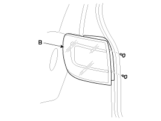
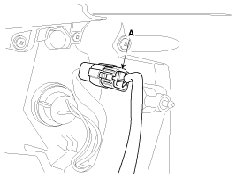
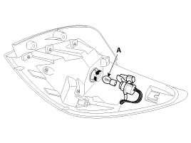
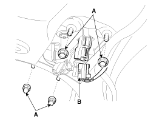
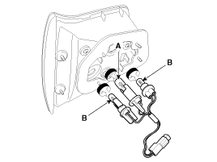

# Kia Sportage: Luz de combinação traseira: Procedimentos de reparo

[Home](../../index.md) / [Manual de Serviço e Reparo do Kia Sportage SL](../sportage-482.md) / [Sistema Elétrico do Corpo](sportage-984.md) / [Sistema de Iluminação](sportage-1131.md) / Procedimentos de reparo da luz de combinação traseira

## Remoção

1. Desconecte o terminal negativo (-) da bateria.

2. Desloque as varetas (2EA) que seguram a luz de combinação traseira, depois desconecte o conector (A) e remova a luz de combinação traseira externa (B).

   

   

3. Vire o suporte no sentido horário para remover a lâmpada do freio (A).

   

4. Desloque as varetas (A) após remover a tampa da luz do porta-malas.

   

5. Remova a luz do porta-malas após desconectar o conector (B).

6. Vire o suporte no sentido horário para remover a lâmpada de ré (A) e a lâmpada do freio (B).

   

7. Se as lâmpadas precisarem apenas ser substituídas sem remover a montagem da luz, substitua a lâmpada de ré (A) e a lâmpada do freio (B) após remover a tampa da luz do porta-malas interna.

## Instalação

1. Instale a montagem da luz de combinação traseira após montar as lâmpadas.

2. Instale a tampa da luz na porta-malas após conectar o conector da luz.

3. Instale a montagem da luz de combinação traseira após montar as lâmpadas e conectar o conector da luz.
