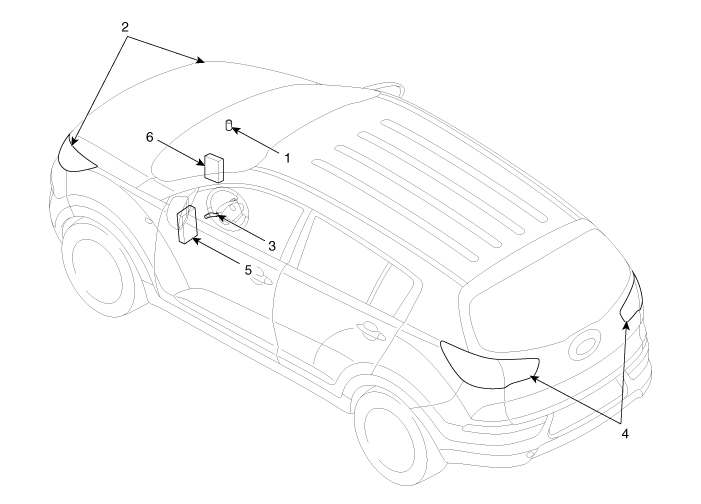

# Sistema de Controle de Iluminação Automática — Componentes e localização

[Home](../../index.md) / [Manual de Serviço e Reparo](../sportage-482.md) / [Sistema Elétrico do Corpo](sportage-984.md) / [Sistema de Controle de Iluminação Automática](sportage-1147.md) / Componentes e localização

## Diagrama

## Legenda

| Nº | Componente |
| --- | --- |
| 1 | Sensor de iluminação automática |
| 2 | Faróis da frente |
| 3 | Interruptor de iluminação (Automático) |
| 4 | Faróis traseiros |
| 5 | SJB (Caixa de Juntamento Inteligente) |
| 6 | BCM (Módulo de Controle do Corpo) |
