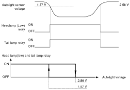
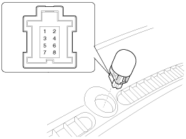
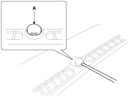

# Kia Sportage: Sensor de Luz Automática: Procedimentos de Reparo

[Home](../../index.md) / [Manual de Serviço e Reparo do Kia Sportage SL](../sportage-482.md) / [Sistema Elétrico do Corpo](sportage-984.md) / [Sistema de Controle de Luz Automática](sportage-1147.md) / Procedimentos de Reparo do Sensor de Luz Automática

## Inspeção

No estado de IGN1 ON, quando o módulo de módulo de troca de funções detecta o interruptor de luz automática, a saída do relé da luz do rabo e a saída do relé da luz de baixa do farol são controladas com base na entrada do sensor de luz automática.

O controle de luz automática não funciona se a pinagem de fornecimento de luz solar (5V de alimentação regulada do Ignição 1 para o sensor de luz solar) estiver em curto-circuito com o chão.

Se o IGN1 estiver ON, o IPM monitora o intervalo dessa alimentação e levanta uma falha assim que a tensão da alimentação estiver fora do intervalo. Então essa falha ocorre e enquanto ela persistir, o farol de baixa deve ser ligado sem se preocupar com o nível de luz solar fornecido pelo sensor.

Isso foi projetado para prevenir qualquer corte no farol de baixa durante a noite quando a falha ocorrer.

## Remoção

1. Desconecte o terminal negativo (-) da bateria.

2. Remova o sensor de foto e de luz automática (A) do lado superior do crash pad usando uma furadeira plana.

   

3. Remova a conexão do sensor de luz automática.

## Instalação

1. Reconecte a conexão do sensor de luz automática.

2. Instale o sensor de luz automática.
