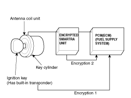
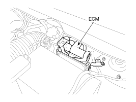
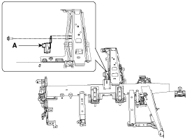
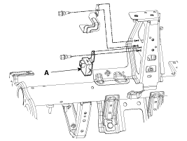
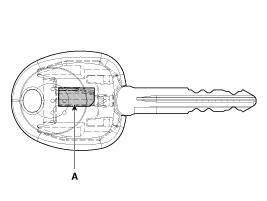
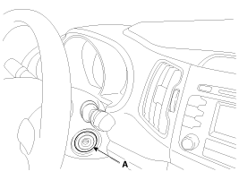

# Kia Sportage: Descrição e Operação

[Home](../../index.md) / [Manual de Serviço e Reparo do Kia Sportage SL](../sportage-482.md) / [Sistema Elétrico do Corpo](sportage-984.md) / [Sistema de Imobilizador](sportage-1153.md) / Descrição e Operação

## Descrição

O sistema de imobilizador desabilitará o veículo a menos que a chave de ignição correta seja usada, além dos sistemas de anti-rádio já disponíveis, como alarmes de carro, o sistema de imobilizador visa drasticamente reduzir a taxa de roubos de veículos.

1. Imobilizador tipo SMARTRA encriptado

   | – | O sistema SMARTRA consiste em um transponder de desafio-resposta passivo (autenticação mutua) localizado na chave de ignição, uma bobina de antena, um módulo SMARTRA codificado, uma luz indicadora e o PCM(ECM). |
   | --- | --- |

   | – | O SMARTRA comunica-se com o PCM(ECM) (Unidade de Controle do Motor) por meio de uma linha de comunicação dedicada. Como o sistema de gerenciamento do motor do veículo pode controlar a mobilização do motor, é a unidade mais adequada para controlar o SMARTRA. |
   | --- | --- |

   | – | Quando a chave é inserida na ignição e girada para a posição ON, a bobina de antena envia energia para o transponder na chave de ignição. O transponder então envia um sinal codificado de volta através do módulo SMARTRA para o PCM(ECM). |
   | --- | --- |

   | – | Se a chave correta foi usada, o PCM(ECM) energizará o sistema de suprimento de combustível. A luz indicadora do imobilizador no painel de instrumentos ficará ligada por mais de cinco segundos, indicando que o módulo SMARTRA reconheceu o código enviado pelo transponder. |
   | --- | --- |

   | – | Se a chave errada foi usada e o código não foi recebido ou reconhecido pelo PCM(ECM), a luz indicadora continuará apagando até que o interruptor de ignição seja desligado. |
   | --- | --- |

   | – | Se for necessário reprogramar o PCM(ECM) para aprender uma nova chave, o concessionário precisará do veículo do cliente, todas as suas chaves e um Hi-scan (pro) equipado com uma cartão de programa de imobilizador. Qualquer chave que não for aprendida durante a reprogramação não mais iniciará o motor. |
   | --- | --- |

   | – | O sistema de imobilizador pode armazenar até oito códigos de chave. |
   | --- | --- |

   | – | Se o cliente perder sua chave e não conseguir iniciar o motor, entre em contato com uma concessionária de serviço Kia. |
   | --- | --- |

   

## Componentes de Operação

PCM (Module de Controle do Tranco)

1. O PCM(ECM) (A) realiza uma verificação da chave de ignição usando um algoritmo de criptografia especial, que está programado no transmissor assim como no PCM(ECM) simultaneamente. Apenas se os resultados forem iguais, o motor pode ser ligado. Os dados de todos os transmissores válidos para o veículo são armazenados no PCM(ECM).

   O valor ERN (Número Aleatório Criptografado) entre EMS e o unitário smartra criptografado é verificado e a validade da chave codificada é decidida pelo EMS.

   

UNITÁRIO SMARTRA CRIPTOGRAFADO (A)

O SMARTRA realiza comunicação com o transmissor integrado na chave de ignição. Esta comunicação sem fio é realizada na RF (Frequência de rádio de 125 kHz). O SMARTRA está montado atrás do painel de impacto próximo ao cruzamento central.

O sinal RF do transmissor, recebido pelo bobina antena, é convertido em mensagens para comunicação serial pelo dispositivo SMARTRA. As mensagens recebidas do PCM(ECM) são convertidas em sinal RF, que é transmitido ao transmissor pela antena.

O SMARTRA não realiza a verificação de validade do transmissor ou o cálculo do algoritmo de criptografia. Este dispositivo é apenas uma interface avançada, que converte o fluxo de dados RF do transmissor em comunicação serial para o PCM(ECM) e vice-versa.

[USA]

[Canadá]

TRANSMISSOR (Chaves integradas)

O transmissor (A) possui um algoritmo de criptografia avançado. Durante o procedimento de ensino da chave, o transmissor será programado com dados específicos do veículo. Os dados específicos do veículo são escritos na memória do transmissor. O procedimento de escrita é único; portanto, o conteúdo do transmissor nunca pode ser modificado ou alterado.

[Tipo de Chave]

Bobina antena

A bobina antena (A) tem as seguintes funções.

| – | A bobina antena fornece energia ao transmissor. |
| --- | --- |

| – | A bobina antena recebe sinal do transmissor. |
| --- | --- |

| – | A bobina antena envia sinal do transmissor para o SMARTRA. Está localizada diretamente à frente do travamento do travão do volante. |
| --- | --- |

