# Kia Sportage: Procedimentos de Reparo

[Início](../../index.md) / [Manual de Serviço e Reparo do Kia Sportage SL](../sportage-482.md) / [Sistema Elétrico do Corpo](sportage-984.md) / [Sistema de Imobilizador](sportage-1153.md) / Procedimentos de Reparo

## Troca

Problemas E Peças de Troca:

| Problema | Conjunto de Peças | Um Escaneador de Diagnóstico é Necessário? |
| --- | --- | --- |
| Todas as chaves foram perdidas | Chave em branco (4) | SIM |
| Unidade de antena não funciona | Unidade de antena | NÃO |
| PCM (ECM) não funciona | PCM (ECM) | SIM |
| Interruptor de ignição não funciona | Interruptor de ignição com unidade de antena | SIM |
| Dados específicos do veículo não identificados ocorrem | Chave, PCM (ECM) | SIM |
| Unidade SMARTRA não funciona | Unidade SMARTRA | SIM |

Troca do PCM (ECM) e SMARTRA

Em caso de PCM (ECM) defeituoso, o módulo tem que ser substituído por um "virgem" ou "neutro". Todas as chaves têm que ser ensinadas ao novo PCM (ECM). Chaves que não foram ensinadas ao PCM (ECM) são inválidas para o novo PCM (ECM) (Consulte o procedimento de ensino de chaves). Os dados específicos do veículo devem permanecer inalterados devido à programação única do transpondedor.

Em caso de SMARTRA defeituosa, é necessário ensinar a SMARTRA. Um novo dispositivo SMARTRA substitui o antigo e a SMARTRA precisa ser ensinada.

1. Coisas a se lembrar antes da troca (PCM (ECM))

   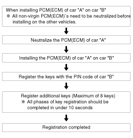

2. Coisas a se lembrar antes da troca (Chaves e registro adicional)

   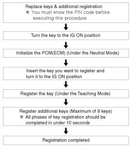

   > **Nota**
   >
   > - Quando há apenas uma chave registrada e você deseja registrar outra chave, é necessário re-ensinar a chave que já estava registrada.
   > - Quando a chave #1 está registrada e a chave mestra #2 não está registrada, coloque a chave #1 no posição IG/ON ou start e remova-a. O motor pode ser ligado com a chave #2 não registrada.
   > - (Lembre-se de que a chave #2 deve ser usada dentro de 10 segundos após a remoção da chave #1)
   > - Quando a chave #1 está registrada e a chave #2 não está registrada, coloque a chave mestra #2 não registrada na posição IG/ON ou start.
   > - O motor não pode ser ligado mesmo com a chave #1 registrada.
   > - Ao examinar o sistema imobilizador, consulte os parágrafos 1, 2 e 3 acima.
   > - Sempre lembre-se da zona de 10 segundos.
   > - Se o código de pin e a senha forem digitados incorretamente em três entradas consecutivas, o sistema ficará bloqueado por uma hora.
   > - Seja cauteloso ao sobrepor as áreas de transponders.
   > - Problemas podem ocorrer na registro de chaves ou no start do veículo se os transponders se sobrepor.

Neutralização do PCM (ECM)

O PCM (ECM) pode ser configurado para o status "neutro" por um teste.

Uma chave válida é inserida e, após o registro do acionamento do ignição, o PCM (ECM) solicita os dados específicos do veículo ao teste. As mensagens de comunicação são descritas em "Modo Neutro". Após a recepção bem-sucedida dos dados, o PCM (ECM) é neutralizado.

O ECM permanece bloqueado. Nem o modo de viagem de emergência nem a função "dois acionamentos do ignição" são aceitas pelo PCM (ECM).

O ensino de chaves segue o procedimento descrito para o PCM (ECM) "virgem". Os dados específicos do veículo devem permanecer inalterados devido à programação única do transpondedor. Se os dados devem ser alterados, novas chaves com transponders "virgens" são solicitadas.

Este é um comando para neutralizar o PCM(ECM) e a chave. Ex) Quando a chave é perdida, neutralize o PCM(ECM) e depois ensine as chaves.

(Referência para as Ações a serem tomadas quando a chave e o código PIN estão ausentes) O PCM(ECM) pode ser colocado em um estado "neutro" por um scanner. Se dados específicos do veículo incorretos forem enviados para a SMATRA três vezes de forma contínua ou intermitente, a SMATRA rejeitará a solicitação de entrar no modo neutro por uma hora. Desconectar a bateria ou outras manipulações não podem reduzir esse tempo. Após conectar a bateria, o temporizador começa novamente por uma hora.

> **Nota**
>
> - Condições de configuração de neutralização
> - No caso de status do PCM(ECM) "Aprendido", independentemente da senha do usuário "Virgin ou Aprendido"
> - Entrar o código PIN correto pelo scanner.
> - Significado da neutralização.
> - : Exclusão do código PIN (6) & senha do usuário (4).
> - : Bloqueio do ECM (exceto permissão de ensino de chave)
> - Significado da neutralização:
> - Exclusão do código PIN (6) & senha do usuário (4)
> - Bloqueio do EMS (exceto permissão de aprendizado de chave)

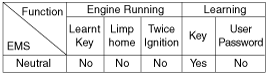

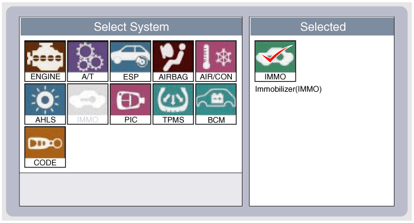

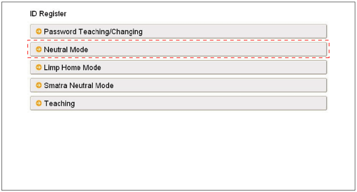

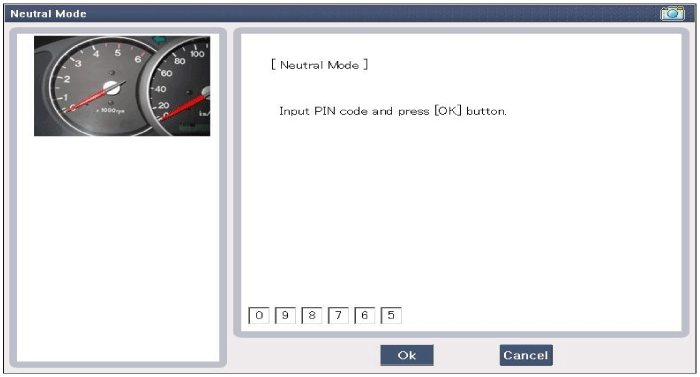

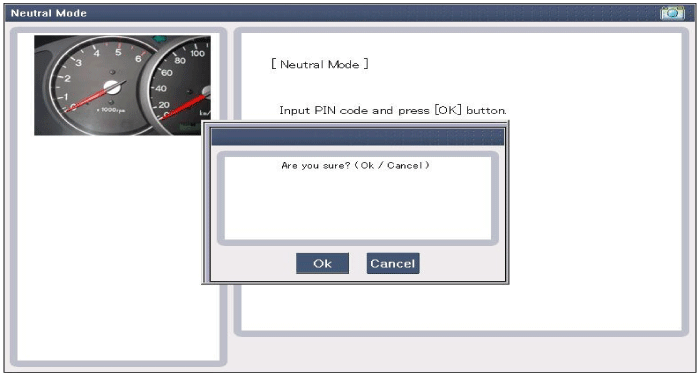

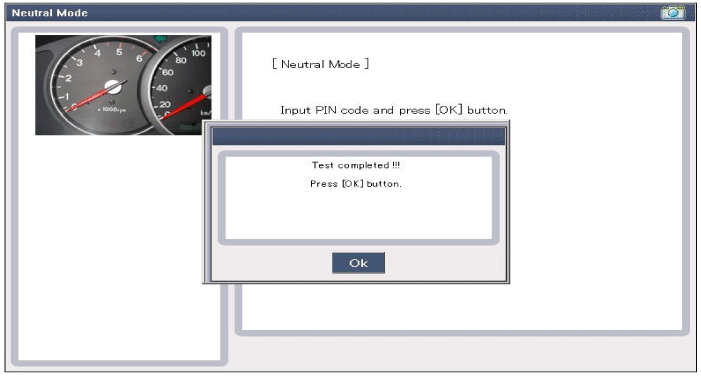

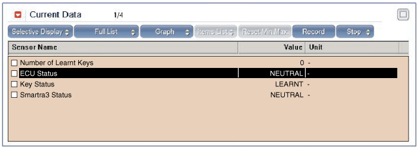

Neutralização da SMARTRA

O EMS pode ser colocado em um estado "neutro" pelo teste

A chave de ignição (independentemente do status da chave) é inserida e após o IGN ON. Se receber a senha do veículo correta do GST, a SMARTRA pode ser neutralizada. A neutralização da SMARTRA é possível se o DPN for o mesmo que o valor inserido pelo GST.

No caso de a SMARTRA estar em um estado neutro, o EMS mantém o estado bloqueado. E o start não é possível por "ignição dupla".

No caso de alterar a senha do veículo, um transponder virgin novo deve ser usado. E no caso de chave virgin, após aprender a chave do código do veículo, ela pode ser usada.

Se dados específicos do veículo incorretos forem enviados para a SMATRA três vezes de forma contínua ou intermitente, a SMATRA rejeitará a solicitação de entrar no modo neutro por uma hora. Desconectar a bateria ou outras manipulações não podem reduzir esse tempo. Após conectar a bateria, o temporizador começa novamente por uma hora.

> **Nota**
>
> - Condições de configuração de neutralização :
> - No caso de "status da SMARTRA", "Aprendido"
> - Entrar o código PIN correto pelo teste
> - Significado da neutralização :
> - Código da senha do veículo (DPN Code) & código SEK exclusão.
> - Permissão de novo aprendizado de DPN.

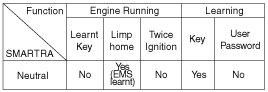

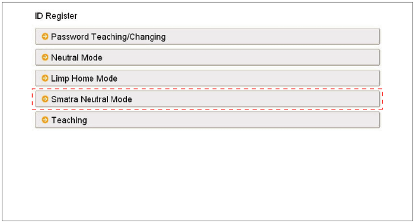

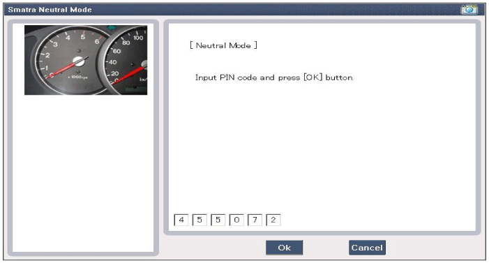

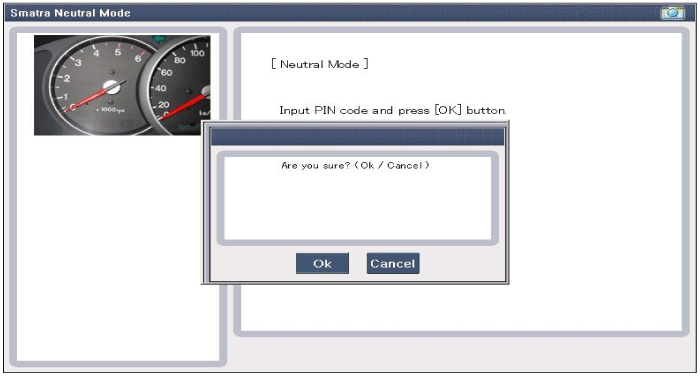

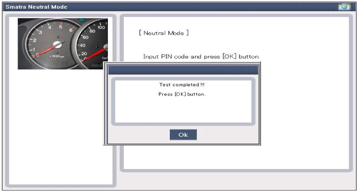

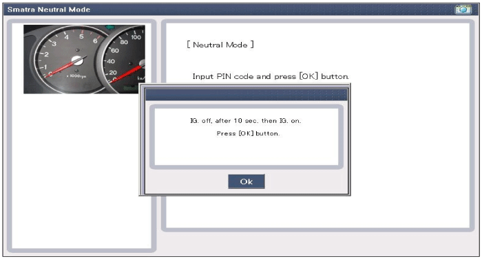

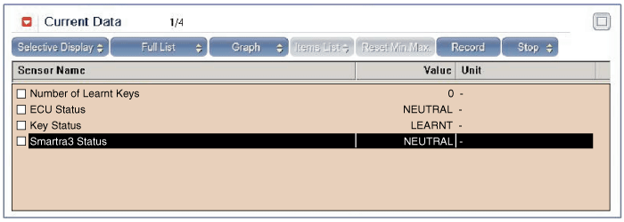

## Procedimentos de Ensino

1. Procedimento de Ensino Chave

   O ensino da chave deve ser realizado após a substituição de um PCM (ECM) defeituoso ou quando se fornecerem chaves adicionais ao proprietário do veículo.

   O procedimento começa com uma solicitação de PCM (ECM) para dados específicos do veículo (código PIN: 6 dígitos) pelo teste. O "virgem" PCM (ECM) armazena os dados específicos do veículo e o ensino da chave pode ser iniciado. O "aprendido" PCM (ECM) compara os dados específicos do veículo do teste com os dados armazenados. Se os dados forem corretos, o ensino pode prosseguir.

   Se dados específicos do veículo incorretos forem enviados ao PCM (ECM) três vezes, o PCM (ECM) rejeitará a solicitação de ensino de chave por uma hora. Esse tempo não pode ser reduzido desligando a bateria ou qualquer outra manipulação. Após a reinicialização da bateria, o temporizador começa novamente por uma hora.

   O ensino da chave é feito com o acionamento do ignição com a chave e com comandos adicionais do teste. O PCM (ECM) armazena os dados relevantes no EEPROM e no transpondedor. Em seguida, o PCM (ECM) executa a autenticação necessária para a confirmação do processo de ensino. A programação bem-sucedida é confirmada por uma mensagem para o teste.

   Se a chave já for conhecida pelo PCM (ECM) de um ensino anterior, a autenticação será aceita e os dados do EEPROM serão atualizados. Não há conteúdo alterado no transpondedor (isso é impossível para um transpondedor aprendido).

   O PCM (ECM) reconhece o tentar ensinar repetidamente uma chave que já tenha sido ensinada durante o mesmo ciclo de ensino. Isso rejeita a chave e uma mensagem é enviada para o teste.

   O PCM (ECM) rejeita chaves inválidas apresentadas para ensino. Uma mensagem é enviada para o teste. A chave pode ser inválida devido a falhas no transpondedor ou outras razões que resultem de uma programação de dados não bem-sucedida. Se o PCM (ECM) detectar autentificadores diferentes de um transpondedor e um PCM (ECM), a chave será considerada inválida.

   O número máximo de chaves ensinadas é 8

   Se ocorrer um erro durante o Menu de Serviço do Imobilizador, o status do PCM (ECM) permanecerá inalterado e um código de falha específico será armazenado.

   Se o status do PCM (ECM) e o status da chave não corresponderem para o ensino de chaves, o procedimento do teste será interrompido e um código de falha específico será armazenado no PCM (ECM).

   > **Nota**
   >
   > - Ao ensinar a 1ª chave, a Smartra registra simultaneamente.

   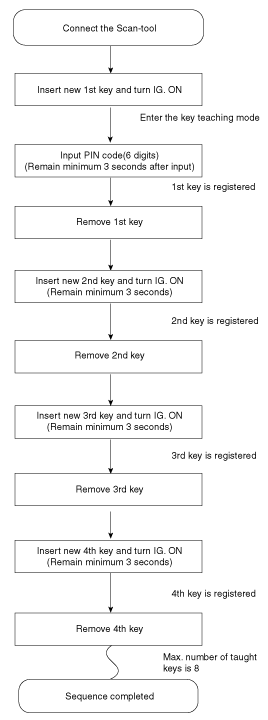

   | (1) | Status de ensino aprendido do PCM (ECM). |
   | --- | --- |

   | (2) | Status de PCM (ECM) virgem. Após a substituição de um novo "PCM (ECM)", o scan tool exibe que o PCM (ECM) está em status virgem no modo de ensino de chaves. "STATUS VIRGEN" significa que o PCM (ECM) não correspondeu a nenhum código PIN antes. |
   | --- | --- |

Ensino/correção de Senha

1. Procedimento de Ensino de Senha do Usuário

   A senha do usuário para o modo de viagem limitado é ensinada na oficina de serviço. O proprietário do veículo pode selecionar um número com quatro dígitos.

A senha do usuário só é aceita por um "aprendido" PCM(ECM). Antes de aprimorar a senha do usuário para um PCM(ECM), o status da senha é "virgem". Não é possível usar a função de retorno limitado.

O aprimoramento é iniciado com a ignição ligada, com uma chave válida (chave aprendida) e enviando a senha do usuário pelo teste. Após o aprimoramento bem-sucedido, o status da senha do usuário muda de "virgem" para "aprendido".

A senha do usuário aprendida também pode ser alterada. Isso pode ser feito se o status da senha do usuário for "aprendido" e o teste enviar a autorização de acesso, seja a antiga senha do usuário ou os dados específicos do veículo. Após a autorização correta, o PCM(ECM) solicita a nova senha do usuário. O status permanece "aprendido" e a nova senha do usuário será válida para o próximo modo de retorno limitado.

Se senhas do usuário erradas ou dados específicos do veículo errados forem enviados ao PCM(ECM) três vezes de forma contínua ou intermitente, o PCM(ECM) rejeitará a solicitação de mudança da senha por uma hora. Esse tempo não pode ser reduzido desligando a bateria ou por qualquer outra ação. Após reconectar a bateria, o temporizador começa novamente por uma hora.

2. Aprimoramento da senha do usuário

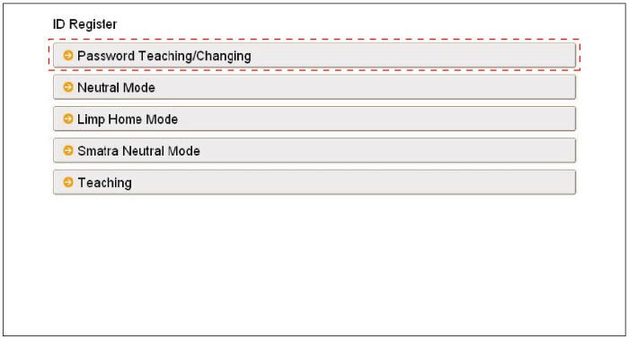

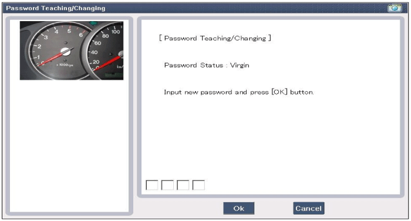

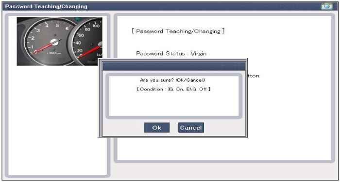

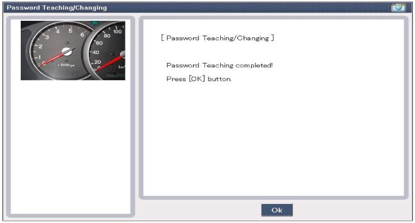

? Em caso de digitar a senha errada, tente novamente do primeiro passo após 10 segundos.

3. Alteração da senha do usuário

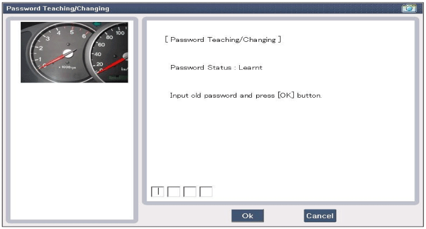

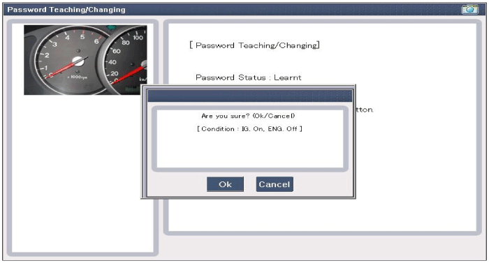

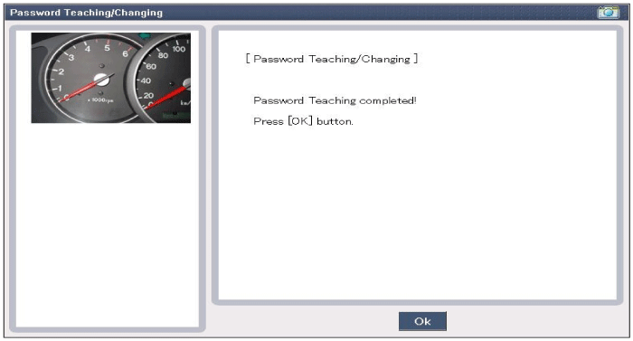

## Função Limp Home

1. Limp Home Por Testador

   Se o PCM(ECM) detectar o defeito do SMARTRA ou
   transmissor, o PCM(ECM) permitirá a função de limp home do
   imobilizador. O limp home é possível apenas se o usuário tiver fornecido
   a senha do usuário (4 dígitos) ao PCM(ECM) antes. Essa senha pode ser
   selecionada pelo proprietário do veículo e programada na oficina.

   A senha do usuário pode ser enviada ao PCM(ECM) via o menu especial do
   testador.

   Apenas se o PCM(ECM) estiver em status "aprendido" e o status da
   senha do usuário for "aprendido" e a senha do usuário for correta, o
   PCM(ECM) será desbloqueado por um período de tempo (30 seg.). O motor
   pode ser iniciado apenas durante esse tempo. Após o tempo expirar,
   o início do motor não é possível.

   Se a senha do usuário incorreta for enviada, o PCM(ECM) rejeitará
   a solicitação de limp home por uma hora. Desconectar a bateria ou
   qualquer outra ação não pode reduzir esse tempo. Após conectar a bateria
   ao PCM(ECM), o temporizador começa novamente por uma hora.

   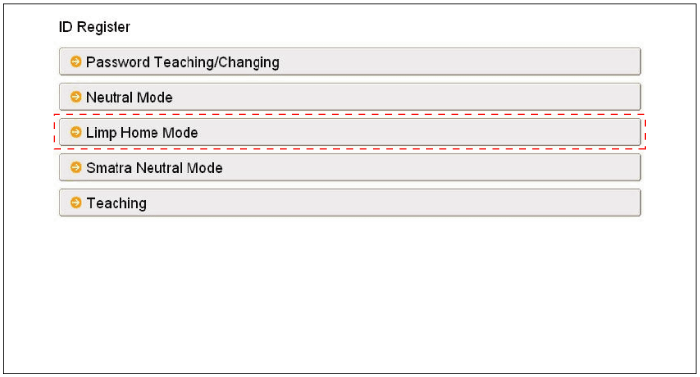

   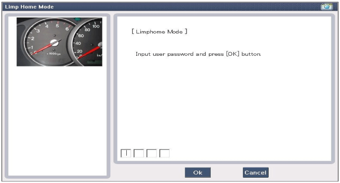

   

   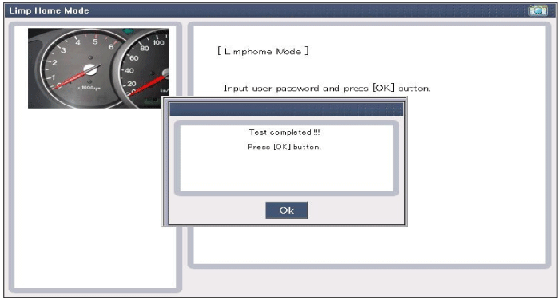

2. Limp Home Por Chave de Ignição

   A função limp home também pode ser ativada pela chave de
   ignição. A senha do usuário pode ser inserida no PCM(ECM) por uma
   sequência especial de ligar/desligar a ignição.

   Apenas se o PCM(ECM) estiver em status "aprendido" e o status da
   senha do usuário for "aprendido" e a senha do usuário for correta, o
   PCM(ECM) será desbloqueado por um período de tempo (30 seg.).

   O motor pode ser iniciado durante esse tempo. Após o tempo
   expirar, o início do motor não é possível. Após a entrada de uma nova
   senha, o temporizador (30 seg.) começará novamente.

   Após o desligamento da ignição, o PCM(ECM) será bloqueado se o
   temporizador tiver expirado 8 segundos. Para o próximo start, a entrada
   da senha do usuário será solicitada novamente.

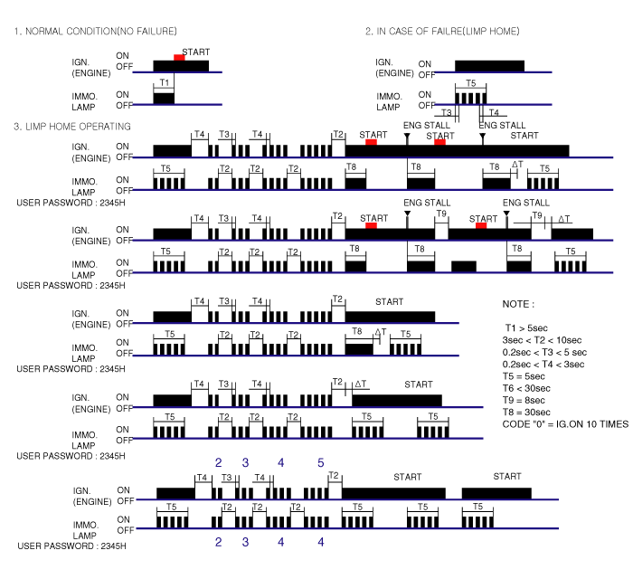
