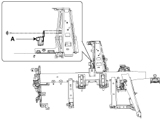
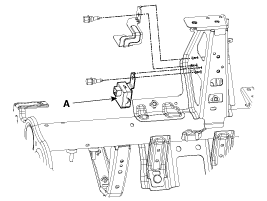

# Kia Sportage: Unidade de Controle do Imobilizador: Procedimentos de Reparo

[Home](../../index.md) / [Manual de Serviço e Reparo do Kia Sportage SL](../sportage-482.md) / [Sistema Elétrico do Corpo](sportage-984.md) / [Sistema de Imobilizador](sportage-1153.md) / Procedimentos de Reparo da Unidade de Controle do Imobilizador

## Remoção

1. Desconecte o terminal negativo (-) da bateria.

2. Remova o painel inferior do crash pad.

   (Consulte o grupo BD - "crash pad")

3. Remova a montagem do coluna de direção.

   (Consulte o grupo ST - "coluna de direção e eixo")

4. Desconecte o conector da unidade SMARTRA e, em seguida, remova a unidade SMARTRA (A) após soltar um parafuso.

   [EUA]

   

   [Canadá]

   Desconecte o conector da unidade SMARTRA (A) e, em seguida, remova o suporte e a unidade de imobilizador.

   

## Instalação

1. Instale a unidade de controle do imobilizador após conectar o conector da unidade.

2. Instale a montagem do coluna de direção.

3. Instale o painel inferior do crash pad.
