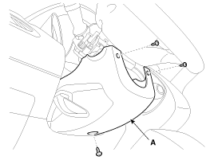
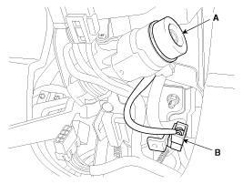

# Kia Sportage: Bobina de Antena: Procedimentos de Reparo

[Home](../../index.md) / [Manual de Serviço e Reparo do Kia Sportage SL](../sportage-482.md) / [Sistema Elétrico do Corpo](sportage-984.md) / [Sistema de Imobilizador](sportage-1153.md) / Procedimentos de Reparo da Bobina de Antena

## Remoção

1. Desconecte o terminal negativo (-) da bateria.

2. Remova as capas superiores e inferiores do pilar do volante (A).

   

   > **Nota**
   >
   > - Cuide para não danificar e arranhar as capas e suas partes relacionadas.
   > - Cuide para não danificar o gancho ao remover as capas superiores e inferiores do pilar do volante.

3. Desconecte o conector 6P (B) da antena de bobina e, em seguida, remova a antena de bobina (A).

   

## Instalação

1. Instale a antena de bobina e conecte o conector 6P.

2. Instale as capas superiores e inferiores do pilar do volante.
